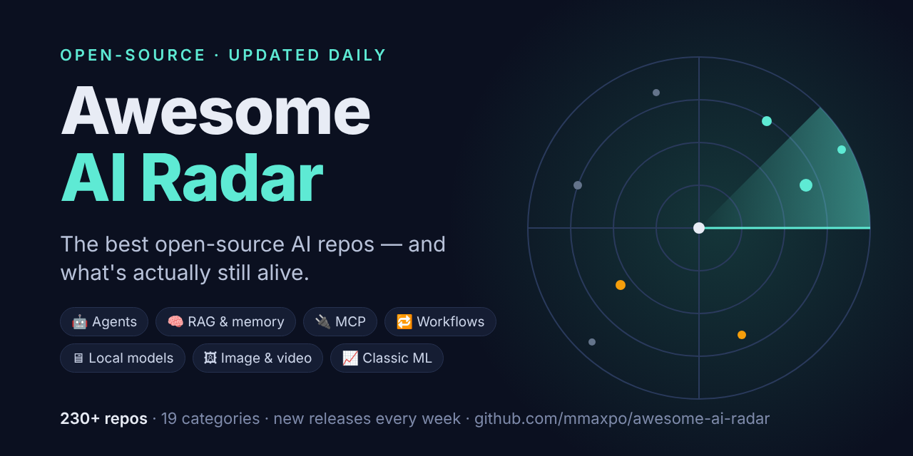

# 📡 Awesome AI Radar



> A curated list of the best open-source AI repos — **that updates itself every day.**

    [](https://github.com/mmaxpo/awesome-ai-radar/issues/new?template=suggest-repo.yml)

Most awesome lists go stale: dead projects sit next to great ones and you can't tell them apart.
This list is checked by a GitHub Action **every day**, so you always see:

- 🔥 **What shipped this week** — new releases and active projects
- 💤 🗄 **What went quiet** — repos with no activity for months, or archived
- 📄 **A detail sheet for every repo** — stars, languages, license, latest releases, recent commits
- 📊 **The whole list as a table** — [`repos.csv`](repos.csv), sortable and searchable

**239 repos · 19 categories · 68 new releases this week** · _last checked 2026-11-14 17:52 UTC_

**Jump to:** [🔥 What's new](#-whats-new-last-7-days) · [🗂 Categories](#-categories) · [📰 Weekly digests](weekly/) · [➕ Suggest a repo](#-suggest-a-repo) · [🛠 Make your own radar](#-make-your-own-radar-in-1-minute)

## 🔥 What's new (last 7 days)

_📰 Readable summary: [this week's digest](weekly/2026-W46.md) · [all weeks](weekly/)_

**📦 New releases**

- **[homeassistant-ai/ha-mcp](repos/homeassistant-ai__ha-mcp.md)** — [v9.3.0.dev3558](https://github.com/homeassistant-ai/ha-mcp/releases/tag/v9.3.0.dev3558) (today) · 🔌 MCP & SDKs
- **[crmne/zapfast](repos/crmne__zapfast.md)** — [v0.21.2](https://github.com/crmne/zapfast/releases/tag/v0.21.2) (today) · 🧰 Open-source utilities
- **[fastapi/fastapi](repos/fastapi__fastapi.md)** — [0.163.0](https://github.com/fastapi/fastapi/releases/tag/0.163.0) (today) · 🐍 Python & backend tooling
- **[heygen-com/hyperframes](repos/heygen-com__hyperframes.md)** — [v0.9.46](https://github.com/heygen-com/hyperframes/releases/tag/v0.9.46) (today) · 🖼 Image & video generation
- **[trycua/cua](repos/trycua__cua.md)** — [cua-spaces-v0.36.14](https://github.com/trycua/cua/releases/tag/cua-spaces-v0.36.14) (today) · 🤖 Agent frameworks & multi-agent
- **[Gathin23/cleanyourtv](repos/Gathin23__cleanyourtv.md)** — [v3.5.0](https://github.com/Gathin23/cleanyourtv/releases/tag/v3.5.0) (today) · 🧰 Open-source utilities
- **[lobehub/lobehub](repos/lobehub__lobehub.md)** — [v0.0.0-nightly.pr23017.39490](https://github.com/lobehub/lobehub/releases/tag/v0.0.0-nightly.pr23017.39490) (today) · 🧩 Low-code builders & chat UIs
- **[Imbad0202/academic-research-skills](repos/Imbad0202__academic-research-skills.md)** — [v3.24.3](https://github.com/Imbad0202/academic-research-skills/releases/tag/v3.24.3) (today) · 🪄 Agent skills & guidance
- **[MervinPraison/PraisonAI](repos/MervinPraison__PraisonAI.md)** — [v4.7.25](https://github.com/MervinPraison/PraisonAI/releases/tag/v4.7.25) (today) · 🤖 Agent frameworks & multi-agent
- **[wkentaro/labelme](repos/wkentaro__labelme.md)** — [v7.11.0](https://github.com/wkentaro/labelme/releases/tag/v7.11.0) (today) · 📈 Classic ML, data science & vision
- **[ranxianglei/billion-context](repos/ranxianglei__billion-context.md)** — [v0.1.214](https://github.com/ranxianglei/billion-context/releases/tag/v0.1.214) (today) · 💻 Coding agents & dev tools
- **[addyosmani/agent-skills](repos/addyosmani__agent-skills.md)** — [0.6.16](https://github.com/addyosmani/agent-skills/releases/tag/0.6.16) (today) · 🪄 Agent skills & guidance
- **[cosmicstack-labs/mercury-agent](repos/cosmicstack-labs__mercury-agent.md)** — [optimus-v0.5.2](https://github.com/cosmicstack-labs/mercury-agent/releases/tag/optimus-v0.5.2) (today) · 🤖 Agent frameworks & multi-agent
- **[horizon-rust/horizon](repos/horizon-rust__horizon.md)** — [launcher@0.2.64](https://github.com/horizon-rust/horizon/releases/tag/launcher%400.2.64) (today) · 🧰 Open-source utilities
- **[meta/astryx](repos/meta__astryx.md)** — [v0.7.16](https://github.com/meta/astryx/releases/tag/v0.7.16) (today) · 🎨 Design & creative
- **[BerriAI/litellm](repos/BerriAI__litellm.md)** — [v1.106.10](https://github.com/BerriAI/litellm/releases/tag/v1.106.10) (today) · 🖥 Models, local inference & gateways
- **[microsoft/playwright-python](repos/microsoft__playwright-python.md)** — [v1.65.2](https://github.com/microsoft/playwright-python/releases/tag/v1.65.2) (today) · 📄 Documents, OCR & web data
- **[pbakaus/impeccable](repos/pbakaus__impeccable.md)** — [cli-v4.9.1](https://github.com/pbakaus/impeccable/releases/tag/cli-v4.9.1) (today) · 🪄 Agent skills & guidance
- **[CopilotKit/CopilotKit](repos/CopilotKit__CopilotKit.md)** — [v1.88.0](https://github.com/CopilotKit/CopilotKit/releases/tag/v1.88.0) (today) · 🧩 Low-code builders & chat UIs
- **[experientiallabs/experiential](repos/experientiallabs__experiential.md)** — [exp-code-v0.1.7](https://github.com/experientiallabs/experiential/releases/tag/exp-code-v0.1.7) (today) · 🤖 Agent frameworks & multi-agent
- **[assistant-ui/assistant-ui](repos/assistant-ui__assistant-ui.md)** — [assistant-ui@0.0.135](https://github.com/assistant-ui/assistant-ui/releases/tag/assistant-ui%400.0.135) (today) · 🧩 Low-code builders & chat UIs
- **[sandbox-quantum/switch](repos/sandbox-quantum__switch.md)** — [switch-agent-controller-v0.31.1-dev.556.g810e5da](https://github.com/sandbox-quantum/switch/releases/tag/switch-agent-controller-v0.31.1-dev.556.g810e5da) (today) · 💻 Coding agents & dev tools
- **[openai/openai-python](repos/openai__openai-python.md)** — [v3.51.0](https://github.com/openai/openai-python/releases/tag/v3.51.0) (today) · 🔌 MCP & SDKs
- **[PrefectHQ/prefect](repos/PrefectHQ__prefect.md)** — [3.9.3](https://github.com/PrefectHQ/prefect/releases/tag/3.9.3) (today) · 🔁 Durable workflows & orchestration
- **[onehumanbeing/esp32-iphone-agent](repos/onehumanbeing__esp32-iphone-agent.md)** — [v1.0.5](https://github.com/onehumanbeing/esp32-iphone-agent/releases/tag/v1.0.5) (yesterday) · 🛠 Apps & other
- **[volcengine/OpenViking](repos/volcengine__OpenViking.md)** — [react@0.1.11](https://github.com/volcengine/OpenViking/releases/tag/react%400.1.11) (yesterday) · 🧠 RAG, memory & chat with your data
- **[e2e-inc/e2e](repos/e2e-inc__e2e.md)** — [@e2e-dev/testmu@0.0.5](https://github.com/e2e-inc/e2e/releases/tag/%40e2e-dev/testmu%400.0.5) (yesterday) · 💻 Coding agents & dev tools
- **[rohitg00/ai-engineering-from-scratch](repos/rohitg00__ai-engineering-from-scratch.md)** — [v2026.11.3](https://github.com/rohitg00/ai-engineering-from-scratch/releases/tag/v2026.11.3) (yesterday) · 📚 Awesome lists & learning
- **[alibaba/open-code-review](repos/alibaba__open-code-review.md)** — [v1.13.9](https://github.com/alibaba/open-code-review/releases/tag/v1.13.9) (yesterday) · 💻 Coding agents & dev tools
- **[anomalyco/opencode](repos/anomalyco__opencode.md)** — [v2.3.0](https://github.com/anomalyco/opencode/releases/tag/v2.3.0) (yesterday) · 💻 Coding agents & dev tools
- **[Twigpine/openclaude](repos/Twigpine__openclaude.md)** — [v0.36.0](https://github.com/Twigpine/openclaude/releases/tag/v0.36.0) (yesterday) · 💻 Coding agents & dev tools
- **[tailscale/tailscale](repos/tailscale__tailscale.md)** — [v1.104.7](https://github.com/tailscale/tailscale/releases/tag/v1.104.7) (yesterday) · 🧰 Open-source utilities
- **[BuilderIO/agent-native](repos/BuilderIO__agent-native.md)** — [@agent-native/creative-context@0.8.71](https://github.com/BuilderIO/agent-native/releases/tag/%40agent-native/creative-context%400.8.71) (yesterday) · 🧩 Low-code builders & chat UIs
- **[jordan-gibbs/hyperresearch](repos/jordan-gibbs__hyperresearch.md)** — [v0.13.2](https://github.com/jordan-gibbs/hyperresearch/releases/tag/v0.13.2) (yesterday) · 🤖 Agent frameworks & multi-agent
- **[thedotmack/claude-mem](repos/thedotmack__claude-mem.md)** — [v15.18.3](https://github.com/thedotmack/claude-mem/releases/tag/v15.18.3) (yesterday) · 🧠 RAG, memory & chat with your data
- **[crewAIInc/crewAI](repos/crewAIInc__crewAI.md)** — [1.15.41](https://github.com/crewAIInc/crewAI/releases/tag/1.15.41) (yesterday) · 🤖 Agent frameworks & multi-agent
- **[agno-agi/agno](repos/agno-agi__agno.md)** — [v3.2.0](https://github.com/agno-agi/agno/releases/tag/v3.2.0) (2d ago) · 🤖 Agent frameworks & multi-agent
- **[jundot/omlx](repos/jundot__omlx.md)** — [v0.8.0rc1](https://github.com/jundot/omlx/releases/tag/v0.8.0rc1) (2d ago) · 🖥 Models, local inference & gateways
- **[BrisklyDev/brisk](repos/BrisklyDev__brisk.md)** — [2.5.0.flatpak-hotfix](https://github.com/BrisklyDev/brisk/releases/tag/2.5.0.flatpak-hotfix) (2d ago) · 🧰 Open-source utilities
- **[OpenHands/OpenHands](repos/OpenHands__OpenHands.md)** — [v1.40.0](https://github.com/OpenHands/OpenHands/releases/tag/v1.40.0) (2d ago) · 💻 Coding agents & dev tools
- **[morluto/rea](repos/morluto__rea.md)** — [rea-agents-6.9.0](https://github.com/morluto/rea/releases/tag/rea-agents-6.9.0) (2d ago) · 🔌 MCP & SDKs
- **[superdesigndev/treg](repos/superdesigndev__treg.md)** — [v1.0.0-beta.2](https://github.com/superdesigndev/treg/releases/tag/v1.0.0-beta.2) (2d ago) · 🔌 MCP & SDKs
- **[openai/codex-security](repos/openai__codex-security.md)** — [action-v0.10.0](https://github.com/openai/codex-security/releases/tag/action-v0.10.0) (2d ago) · 🛡 Security & OSINT
- **[zed-industries/zed](repos/zed-industries__zed.md)** — [v1.28.1](https://github.com/zed-industries/zed/releases/tag/v1.28.1) (2d ago) · 💻 Coding agents & dev tools
- **[JuneYaooo/rea-video](repos/JuneYaooo__rea-video.md)** — [v0.1.0](https://github.com/JuneYaooo/rea-video/releases/tag/v0.1.0) (3d ago) · 🖼 Image & video generation
- **[Significant-Gravitas/AutoGPT](repos/Significant-Gravitas__AutoGPT.md)** — [autogpt-platform-beta-v0.11.2](https://github.com/Significant-Gravitas/AutoGPT/releases/tag/autogpt-platform-beta-v0.11.2) (3d ago) · 🤖 Agent frameworks & multi-agent
- **[penpot/penpot](repos/penpot__penpot.md)** — [2.19.1](https://github.com/penpot/penpot/releases/tag/2.19.1) (3d ago) · 🎨 Design & creative
- **[modelcontextprotocol/servers](repos/modelcontextprotocol__servers.md)** — [v2.4.0](https://github.com/modelcontextprotocol/servers/releases/tag/v2.4.0) (3d ago) · 🔌 MCP & SDKs
- **[openinterpreter/openinterpreter](repos/openinterpreter__openinterpreter.md)** — [rust-v0.0.61](https://github.com/openinterpreter/openinterpreter/releases/tag/rust-v0.0.61) (3d ago) · 💻 Coding agents & dev tools
- **[mbillow/localthings](repos/mbillow__localthings.md)** — [v0.38.0](https://github.com/mbillow/localthings/releases/tag/v0.38.0) (3d ago) · 🧰 Open-source utilities
- **[pizza-bot-app/pizza-bot](repos/pizza-bot-app__pizza-bot.md)** — [v1.3.0](https://github.com/pizza-bot-app/pizza-bot/releases/tag/v1.3.0) (3d ago) · 🛠 Apps & other
- **[langflow-ai/langflow](repos/langflow-ai__langflow.md)** — [v1.13.2](https://github.com/langflow-ai/langflow/releases/tag/v1.13.2) (3d ago) · 🧩 Low-code builders & chat UIs
- **[Comfy-Org/ComfyUI](repos/Comfy-Org__ComfyUI.md)** — [v0.45.0](https://github.com/Comfy-Org/ComfyUI/releases/tag/v0.45.0) (3d ago) · 🖼 Image & video generation
- **[jacklandrin/OnlySwitch](repos/jacklandrin__OnlySwitch.md)** — [release_3.6.0](https://github.com/jacklandrin/OnlySwitch/releases/tag/release_3.6.0) (3d ago) · 🧰 Open-source utilities
- **[NandhaKishorM/laya](repos/NandhaKishorM__laya.md)** — [v0.4.31](https://github.com/NandhaKishorM/laya/releases/tag/v0.4.31) (3d ago) · 🖥 Models, local inference & gateways
- **[dbos-inc/dbos-transact-py](repos/dbos-inc__dbos-transact-py.md)** — [3.5.0](https://github.com/dbos-inc/dbos-transact-py/releases/tag/3.5.0) (4d ago) · 🔁 Durable workflows & orchestration
- **[stanfordnlp/dspy](repos/stanfordnlp__dspy.md)** — [3.5.0](https://github.com/stanfordnlp/dspy/releases/tag/3.5.0) (4d ago) · ✍️ Prompting & LLM programming
- **[vectorize-io/hindsight](repos/vectorize-io__hindsight.md)** — [v1.2.1](https://github.com/vectorize-io/hindsight/releases/tag/v1.2.1) (4d ago) · 🧠 RAG, memory & chat with your data
- **[lmcinnes/umap](repos/lmcinnes__umap.md)** — [release-0.6.0](https://github.com/lmcinnes/umap/releases/tag/release-0.6.0) (4d ago) · 📈 Classic ML, data science & vision
- **[earendil-works/pi](repos/earendil-works__pi.md)** — [v1.5.2](https://github.com/earendil-works/pi/releases/tag/v1.5.2) (4d ago) · 💻 Coding agents & dev tools
- **[yctimlin/mcp_excalidraw](repos/yctimlin__mcp_excalidraw.md)** — [v2.2.0](https://github.com/yctimlin/mcp_excalidraw/releases/tag/v2.2.0) (4d ago) · 🔌 MCP & SDKs
- **[Biohub/esm](repos/Biohub__esm.md)** — [v3.4.3](https://github.com/Biohub/esm/releases/tag/v3.4.3) (4d ago) · 🧬 AI for science
- **[ollama/ollama](repos/ollama__ollama.md)** — [v0.40.16](https://github.com/ollama/ollama/releases/tag/v0.40.16) (4d ago) · 🖥 Models, local inference & gateways
- **[assafelovic/gpt-researcher](repos/assafelovic__gpt-researcher.md)** — [v3.8.0](https://github.com/assafelovic/gpt-researcher/releases/tag/v3.8.0) (5d ago) · 🤖 Agent frameworks & multi-agent
- **[ai-job-search-dev/ai-job-search](repos/ai-job-search-dev__ai-job-search.md)** — [v1.7.5](https://github.com/ai-job-search-dev/ai-job-search/releases/tag/v1.7.5) (5d ago) · 🛠 Apps & other
- **[pypa/pipenv](repos/pypa__pipenv.md)** — [v2026.11.0](https://github.com/pypa/pipenv/releases/tag/v2026.11.0) (5d ago) · 🐍 Python & backend tooling
- **[tinacms/tinacms](repos/tinacms__tinacms.md)** — [tinacms@3.15.2](https://github.com/tinacms/tinacms/releases/tag/tinacms%403.15.2) (5d ago) · 🧰 Open-source utilities
- **[vastsa/PI-Desktop](repos/vastsa__PI-Desktop.md)** — [v0.22.0](https://github.com/vastsa/PI-Desktop/releases/tag/v0.22.0) (6d ago) · 💻 Coding agents & dev tools

<details><summary><b>🔨 New commits only</b> (87 repos)</summary>

- **[getopenscreen/openscreen](repos/getopenscreen__openscreen.md)** (today): _fix(linux): take the v1 path on an empty cursor-mode mask_
- **[google/ax](repos/google__ax.md)** (today): _task: update v1alpha1 Task and ObjectMeta schema and update codebase …_
- **[paperclipai/paperclip](repos/paperclipai__paperclip.md)** (today): _perf(recovery): stop re-asserting a failed legacy run whose decision …_
- **[asgeirtj/system_prompts_leaks](repos/asgeirtj__system_prompts_leaks.md)** (today): _Add Claude Docs connector guide and tools_
- **[pytorch/pytorch](repos/pytorch__pytorch.md)** (today): _[decomp] add `aten._trilinear` decomposition (#202958)_
- **[openai/openai-agents-python](repos/openai__openai-agents-python.md)** (today): _fix(deps): update python-multipart requirement from >=0.0.32 to >=0.0…_
- **[ancsemi/Haven](repos/ancsemi__Haven.md)** (today): _Release 4.29.0-beta.5_
- **[davila7/claude-code-templates](repos/davila7__claude-code-templates.md)** (today): _dashboard: home title from counts.json, richer Organization sameAs (#…_
- **[tensorflow/tensorflow](repos/tensorflow__tensorflow.md)** (today): _Automated Code Change_
- **[pandas-dev/pandas](repos/pandas-dev__pandas.md)** (today): _ENH: Unbox scalars from Index.min/max on EAs under future.python_scal…_
- **[bilawalsidhu/gods-eye-view](repos/bilawalsidhu__gods-eye-view.md)** (today): _Merge pull request #1732 from bilawalsidhu/fix/adsblol-true-heading_
- **[abi/screenshot-to-code](repos/abi__screenshot-to-code.md)** (today): _README: fix nested link on the hosted version line_
- **[PyO3/pyo3](repos/PyO3__pyo3.md)** (today): _Fix Python logging example in documentation (#6581)_
- **[JustVugg/colibri](repos/JustVugg__colibri.md)** (today): _Merge pull request #2530 from JustVugg/dev_
- **[nextlevelbuilder/ui-ux-pro-max-skill](repos/nextlevelbuilder__ui-ux-pro-max-skill.md)** (today): _fix(cli): match dry-run sub-skill copies to installs (#571)_
- **[plasma-umass/scalene](repos/plasma-umass__scalene.md)** (today): _Classify signal-path CPU samples by when the timer signal arrived (#1…_
- **[python-websockets/websockets](repos/python-websockets__websockets.md)** (today): _Don't test uvloop under PyPy._
- **[restatedev/restate](repos/restatedev__restate.md)** (today): _[Storage] Configurable backfill slice size, without filling the block…_
- **[google/skills](repos/google__skills.md)** (today): _Update Compute reservations and GKE multitenancy and Workload Identit…_
- **[anthropics/skills](repos/anthropics__skills.md)** (today): _Update docx, pptx, xlsx, and pdf skills (#2217)_
- **[vercel-labs/json-render](repos/vercel-labs__json-render.md)** (today): _fix: stop spec replay from mutating message parts (#453)_
- **[GoogleChrome/modern-web-guidance-src](repos/GoogleChrome__modern-web-guidance-src.md)** (today): _Reset scrollbar width in legacy color fallback and fix macOS notes (#…_
- **[android/nowinandroid](repos/android__nowinandroid.md)** (today): _Merge pull request #2142 from arazosman/nav3DeepLink_
- **[continuedev/continue](repos/continuedev__continue.md)** (today): _docs: remove Sign in link (login flow retired) (#13005)_
- **[cython/cython](repos/cython__cython.md)** (today): _CI: Compare changed file counts numerically in file-changes job (#8139)_
- **[firecrawl/firecrawl](repos/firecrawl__firecrawl.md)** (today): _perf(api): relay the fresh feed's encoded response (#5748)_
- **[temporalio/temporal](repos/temporalio__temporal.md)** (today): _WHN metrics 2: add Update-aware WHN metrics with read-only registry c…_
- **[jupyterlab/jupyterlab](repos/jupyterlab__jupyterlab.md)** (today): _Bump the pip group across 1 directory with 10 updates (#20316)_
- **[DavidHDev/react-bits](repos/DavidHDev__react-bits.md)** (today): _fix(Scanner): only lose WebGL context on real unmount (fixes StrictMo…_
- **[elementalsouls/Claude-BugHunter](repos/elementalsouls__Claude-BugHunter.md)** (today): _chore(assets): refresh star history chart_
- **[oomol-lab/pdf-craft](repos/oomol-lab__pdf-craft.md)** (today): _Localize the top online conversion links in two READMEs (#666)_
- **[catboost/catboost](repos/catboost__catboost.md)** (today): _Skip redundant chmod on cached executables_
- **[casey/just](repos/casey__just.md)** (today): _Ignore comments inside delimiters (#3778)_
- **[NVIDIA/Model-Optimizer](repos/NVIDIA__Model-Optimizer.md)** (today): _[6437794] Fix ONNX autotune verbose logging (#3382)_
- **[JoshuaC215/agent-service-toolkit](repos/JoshuaC215__agent-service-toolkit.md)** (today): _chore(deps): bump setuptools from 84.0.0 to 84.1.0 (#407)_
- **[sherlock-project/sherlock](repos/sherlock-project__sherlock.md)** (today): _update banner layout_
- **[opencv/opencv](repos/opencv__opencv.md)** (today): _Fix dead links in Python tutorials (#30775)_
- **[mrkai77/Loop](repos/mrkai77__Loop.md)** (today): _🐞 Fix delayed gesture availability after login (#1209)_
- **[SeleniumHQ/selenium](repos/SeleniumHQ__selenium.md)** (today): _[java] publish auto-service-annotations again so -Xlint builds pass (…_
- **[Unstructured-IO/unstructured](repos/Unstructured-IO__unstructured.md)** (today): _fix(ci): repair partition benchmark dependencies (#4733)_
- **[cursor/plugins](repos/cursor__plugins.md)** (today): _Merge pull request #1229 from cursor/add-runta-plugin_
- **[keras-team/keras](repos/keras-team__keras.md)** (today): _Check each op inside a functional Model in OpTest (#24240)_
- **[cline/cline](repos/cline__cline.md)** (today): _refactor(vscode): migrate xAI provider settings to GenericProviderSet…_
- **[evansd/whitenoise](repos/evansd__whitenoise.md)** (today): _Get test coverage to 100% (#737)_
- **[Mintplex-Labs/anything-llm](repos/Mintplex-Labs__anything-llm.md)** (today): _Mobile document picker UI (#7125)_
- **[tesseract-ocr/tesseract](repos/tesseract-ocr__tesseract.md)** (today): _Fix download of ae_Arab.ttf for the unit tests (#4687)_
- **[chriswritescode-dev/opencode-manager](repos/chriswritescode-dev__opencode-manager.md)** (today): _Merge pull request #485 from chriswritescode-dev/chore/prune-redundan…_
- **[botpress/botpress](repos/botpress__botpress.md)** (today): _fix(llmz): cap code results and error dumps sent to the model (0.9.23…_
- **[fosrl/pangolin](repos/fosrl__pangolin.md)** (today): _Merge pull request #4097 from berndderidder/update-node_
- **[snownico0722/PaperTodo](repos/snownico0722__PaperTodo.md)** (today): _修复主胶囊回飞末帧在 WPF 布局期间交接导致的崩溃 [ci] (#457)_
- **[motiondivision/motion](repos/motiondivision__motion.md)** (today): _v14.14.0_
- **[zylon-ai/private-gpt](repos/zylon-ai__private-gpt.md)** (yesterday): _fix(settings): wire HTTPS_PROXY to the proxy.https_proxy field (#2432)_
- **[openremote/core](repos/openremote__core.md)** (yesterday): _Remove Balena files (#3570)_
- **[cables-gl/cables](repos/cables-gl__cables.md)** (yesterday): _copytexture anisotropic https://github.com/cables-gl/cables/issues/7344_
- **[ethanplusai/sellbird](repos/ethanplusai__sellbird.md)** (yesterday): _Merge pull request #238 from ethanplusai/fix/no-tip-status_
- **[paper-design/shaders](repos/paper-design__shaders.md)** (yesterday): _new pic uploaded to the docs image-filters_
- **[harry0703/MoneyPrinterTurbo](repos/harry0703__MoneyPrinterTurbo.md)** (yesterday): _docs: update packaging examples to current release_
- **[magicuidesign/magicui](repos/magicuidesign__magicui.md)** (yesterday): _feat(tweet-card): add logo prop to switch to the X logo (#1086)_
- **[scikit-learn/scikit-learn](repos/scikit-learn__scikit-learn.md)** (yesterday): _TST Fix PCA array API checks on rank-deficient data and update array-…_
- **[mattpocock/skills](repos/mattpocock__skills.md)** (yesterday): _Merge pull request #1416 from mattpocock/software-factory-task-wording_
- **[shadcn-ui/ui](repos/shadcn-ui__ui.md)** (yesterday): _chore(deps): bump the deps group (#12691)_
- **[ahujasid/mcp-for-blender](repos/ahujasid__mcp-for-blender.md)** (yesterday): _fix: change configuration for claude review_
- **[cathrynlavery/diagram-design](repos/cathrynlavery__diagram-design.md)** (yesterday): _chore(release): bump plugin manifests to 2.6.164_
- **[numba/numba](repos/numba__numba.md)** (2d ago): _Merge pull request #10973 from sebastianbreguel/fix/partition-negativ…_
- **[modelscope/DiffSynth-Studio](repos/modelscope__DiffSynth-Studio.md)** (2d ago): _support comfy-h3image-prune (#1825)_
- **[microsoft/autogen](repos/microsoft__autogen.md)** (2d ago): _docs: build stable and 0.7.5 from caution docs branch (#8476)_
- **[meta/prophet](repos/meta__prophet.md)** (3d ago): _fix: reject NaN holiday windows instead of silently dropping the rang…_
- **[dmlc/xgboost](repos/dmlc__xgboost.md)** (3d ago): _Skip unused features in GPU SHAP interaction finalization (#12825)_
- **[cherry-embedded/CherryUSB](repos/cherry-embedded__CherryUSB.md)** (3d ago): _fix(port/wch usbhsd): Fix the TOG mismatch issue following a bus rese…_
- **[Shubhamsaboo/awesome-llm-apps](repos/Shubhamsaboo__awesome-llm-apps.md)** (3d ago): _Merge pull request #1277 from elizabethfuentes12/add-dependency-upgra…_
- **[kyrolabs/awesome-langchain](repos/kyrolabs__awesome-langchain.md)** (3d ago): _Mark Flowise as archived (end of life August 31, 2026) (#605)_
- **[localsend/localsend](repos/localsend__localsend.md)** (3d ago): _fix(linux): resolve the tray icon to an absolute path on Snap (#3354)_
- **[rxhanson/Rectangle](repos/rxhanson__Rectangle.md)** (3d ago): _Add a download and update section for mainland China users to README.…_
- **[dmunozv04/iSponsorBlockTV](repos/dmunozv04__iSponsorBlockTV.md)** (3d ago): _Merge pull request #509 from katsugtgz/deps/aiohttp-3.14.4_
- **[huggingface/smolagents](repos/huggingface__smolagents.md)** (3d ago): _Bump doc-builder workflow pin (#2906)_
- **[lmstudio-ai/lms](repos/lmstudio-ai__lms.md)** (3d ago): _Add lms link agent commands (#663)_
- **[benfred/py-spy](repos/benfred__py-spy.md)** (4d ago): _Refactor interpreter macros (#904)_
- **[NationalSecurityAgency/ghidra](repos/NationalSecurityAgency__ghidra.md)** (4d ago): _Merge branch_
- **[aonez/Keka](repos/aonez__Keka.md)** (4d ago): _Fixed typo in the Ukranian translation_
- **[The-Vibe-Company/quivr](repos/The-Vibe-Company__quivr.md)** (5d ago): _test(demo): walk every main journey of the demo with TesterArmy e2e (…_
- **[Netflix/metaflow](repos/Netflix__metaflow.md)** (5d ago): _fix(cards): prevent Table.from_dataframe from mutating input DataFram…_
- **[msitarzewski/agency-agents](repos/msitarzewski__agency-agents.md)** (5d ago): _Merge pull request #1253 from msitarzewski/integ/content-batch8_
- **[swiftbar/SwiftBar](repos/swiftbar__SwiftBar.md)** (5d ago): _chore(release): prepare unsigned build 627 handoff_
- **[Leonxlnx/taste-skill](repos/Leonxlnx__taste-skill.md)** (5d ago): _Merge pull request #196 from Leonxlnx/v2.5.1_
- **[virgiliojr94/book-to-skill](repos/virgiliojr94__book-to-skill.md)** (5d ago): _test(cli): add entry-point tests for cli.py and __main__.py (#90)_
- **[codecrafters-io/build-your-own-x](repos/codecrafters-io__build-your-own-x.md)** (6d ago): _Merge pull request #2089 from thejesh23/add-vector-db-from-scratch_
- **[Panniantong/Agent-Reach](repos/Panniantong__Agent-Reach.md)** (6d ago): _Merge pull request #934 from Panniantong/fix/reddit-linkedin-instagra…_

</details>

## 🗂 Categories

[🤖 Agent frameworks & multi-agent](#-agent-frameworks--multi-agent) (24) · [💻 Coding agents & dev tools](#-coding-agents--dev-tools) (21) · [🔁 Durable workflows & orchestration](#-durable-workflows--orchestration) (6) · [🪄 Agent skills & guidance](#-agent-skills--guidance) (16) · [🧠 RAG, memory & chat with your data](#-rag-memory--chat-with-your-data) (9) · [📄 Documents, OCR & web data](#-documents-ocr--web-data) (8) · [🖥 Models, local inference & gateways](#-models-local-inference--gateways) (13) · [📈 Classic ML, data science & vision](#-classic-ml-data-science--vision) (10) · [🧬 AI for science](#-ai-for-science) (2) · [🔌 MCP & SDKs](#-mcp--sdks) (11) · [🛡 Security & OSINT](#-security--osint) (5) · [🧩 Low-code builders & chat UIs](#-low-code-builders--chat-uis) (11) · [✍️ Prompting & LLM programming](#-prompting--llm-programming) (2) · [🖼 Image & video generation](#-image--video-generation) (9) · [🎨 Design & creative](#-design--creative) (16) · [🐍 Python & backend tooling](#-python--backend-tooling) (12) · [📚 Awesome lists & learning](#-awesome-lists--learning) (11) · [🧰 Open-source utilities](#-open-source-utilities) (33) · [🛠 Apps & other](#-apps--other) (7) · [📎 More resources](#-more-resources) (96) · [🪦 Discontinued & archived](#-discontinued--archived) (13) · [🏢 Organizations](#-organizations) (12)

## 🤖 Agent frameworks & multi-agent

| Repo | Why it's worth a look | ⭐ | Last activity | Latest release |
|---|---|---|---|---|
| [**Significant-Gravitas/AutoGPT**](repos/Significant-Gravitas__AutoGPT.md) 🆕<br><sub>AutoGPT is the vision of accessible AI for everyone, to use and to build on. Our mission is to provide the too…</sub> | The original autonomous-agent project, now an agent-building platform | 188.0k | today | [autogpt-platform-beta-v0.11.2](https://github.com/Significant-Gravitas/AutoGPT/releases/tag/autogpt-platform-beta-v0.11.2) · 3d ago |
| [**msitarzewski/agency-agents**](repos/msitarzewski__agency-agents.md) 🆕<br><sub>A complete AI agency at your fingertips - From frontend wizards to Reddit community ninjas, from whimsy inject…</sub> | Library of ready-made specialist agent personas | 168.3k | 5d ago | — |
| [**paperclipai/paperclip**](repos/paperclipai__paperclip.md) 🆕<br><sub>The open-source app everyone uses to manage agents at work</sub> | Framework for running an organization of agents | 113.9k | today | [v2026.1106.0](https://github.com/paperclipai/paperclip/releases/tag/v2026.1106.0) · 7d ago |
| [**Panniantong/Agent-Reach**](repos/Panniantong__Agent-Reach.md) 🆕<br><sub>Give your AI agent eyes to see the entire internet. Read & search Twitter, Reddit, YouTube, GitHub, Bilibili, …</sub> | Gives agents access to information across the internet | 111.8k | 6d ago | [v1.6.1](https://github.com/Panniantong/Agent-Reach/releases/tag/v1.6.1) · 13d ago |
| [**FoundationAgents/MetaGPT**](repos/FoundationAgents__MetaGPT.md) 💤<br><sub>🌟 The Multi-Agent Framework: First AI Software Company, Towards Natural Language Programming</sub> | Multi-agent 'software company' (PM, architect, engineer) | 71.3k | 9mo ago | [v0.8.2](https://github.com/FoundationAgents/MetaGPT/releases/tag/v0.8.2) · 1y ago |
| [**microsoft/autogen**](repos/microsoft__autogen.md) 🆕<br><sub>A programming framework for agentic AI</sub> | Microsoft's multi-agent conversation framework | 61.8k | 2d ago | [python-v0.7.5](https://github.com/microsoft/autogen/releases/tag/python-v0.7.5) · 1y ago |
| [**crewAIInc/crewAI**](repos/crewAIInc__crewAI.md) 🆕<br><sub>Framework for orchestrating role-playing, autonomous AI agents. By fostering collaborative intelligence, CrewA…</sub> | Role-based agent teams (crews) working on tasks | 60.9k | today | [1.15.41](https://github.com/crewAIInc/crewAI/releases/tag/1.15.41) · yesterday |
| [**HKUDS/CLI-Anything**](repos/HKUDS__CLI-Anything.md)<br><sub>"CLI-Anything: Making ALL Software Agent-Native" -- CLI-Hub: https://clianything.cc/</sub> | Wraps any software in a CLI so AI agents can operate it | 58.7k | 1mo ago | [v0.4.0](https://github.com/HKUDS/CLI-Anything/releases/tag/v0.4.0) · 4mo ago |
| [**agno-agi/agno**](repos/agno-agi__agno.md) 🆕<br><sub>The self-managing agent platform</sub> | Fast framework for agents with memory, tools and teams | 43.2k | today | [v3.2.0](https://github.com/agno-agi/agno/releases/tag/v3.2.0) · 2d ago |
| [**OpenBMB/ChatDev**](repos/OpenBMB__ChatDev.md)<br><sub>ChatDev 2.0: Dev All through LLM-powered Multi-Agent Collaboration</sub> | Virtual software company of chatting agents | 34.7k | 8d ago | [v2.2.0](https://github.com/OpenBMB/ChatDev/releases/tag/v2.2.0) · 7mo ago |
| [**trycua/cua**](repos/trycua__cua.md) 🆕<br><sub>Scale computer-use 2.0 with open-source drivers, cross-OS sandboxes, and benchmarks for training, evaluation, …</sub> | Computer-use agents with local VMs | 32.3k | today | [cua-spaces-v0.36.14](https://github.com/trycua/cua/releases/tag/cua-spaces-v0.36.14) · today |
| [**assafelovic/gpt-researcher**](repos/assafelovic__gpt-researcher.md) 🆕<br><sub>An autonomous agent that conducts deep research on any data using any LLM providers</sub> | Autonomous agent that researches and writes reports | 30.7k | yesterday | [v3.8.0](https://github.com/assafelovic/gpt-researcher/releases/tag/v3.8.0) · 5d ago |
| [**openai/openai-agents-python**](repos/openai__openai-agents-python.md) 🆕<br><sub>A lightweight, powerful framework for multi-agent workflows</sub> | OpenAI's official lightweight multi-agent SDK | 30.7k | today | [v0.24.0](https://github.com/openai/openai-agents-python/releases/tag/v0.24.0) · 1mo ago |
| [**huggingface/smolagents**](repos/huggingface__smolagents.md) 🆕<br><sub>🤗 smolagents: a barebones library for agents that think in code.</sub> | Hugging Face's small, code-first agent library: agents write and run Python instead of JSON tool calls. --- _Generated by [Claude Code](https://claude.ai/code)_ | 30.4k | 3d ago | [v1.26.0](https://github.com/huggingface/smolagents/releases/tag/v1.26.0) · 5mo ago |
| [**letta-ai/letta**](repos/letta-ai__letta.md)<br><sub>Platform for stateful agents: AI with advanced memory that can learn and self-improve over time.</sub> | Stateful agents with long-term memory (ex-MemGPT) | 25.4k | 26d ago | [0.16.8](https://github.com/letta-ai/letta/releases/tag/0.16.8) · 6mo ago |
| [**experientiallabs/experiential**](repos/experientiallabs__experiential.md) 🆕<br><sub>Experiential is the open source, zero markup gateway for BYOK, self-hosted and 1000+ marketplace models. It le…</sub> | Gateway and router for agent workflows | 17.0k | today | [exp-code-v0.1.7](https://github.com/experientiallabs/experiential/releases/tag/exp-code-v0.1.7) · today |
| [**MervinPraison/PraisonAI**](repos/MervinPraison__PraisonAI.md) 🆕<br><sub>Private AI agents for highly regulated teams, and for anyone who wants AI on their own computer. Open-source P…</sub> | Low-code multi-agent framework | 9.3k | today | [v4.7.25](https://github.com/MervinPraison/PraisonAI/releases/tag/v4.7.25) · today |
| [**OpenBMB/XAgent**](repos/OpenBMB__XAgent.md)<br><sub>An Autonomous LLM Agent for Complex Task Solving</sub> | Autonomous agent for complex task solving | 8.6k | 3mo ago | [v1.0.0](https://github.com/OpenBMB/XAgent/releases/tag/v1.0.0) · 2y ago |
| [**the-open-agent/openagent**](repos/the-open-agent__openagent.md)<br><sub>⚡️next-generation personal AI assistant powered by LLM, RAG and agent loops, supporting computer-use, browser-…</sub> | Open agent platform | 5.7k | 8d ago | [v2.95.1](https://github.com/the-open-agent/openagent/releases/tag/v2.95.1) · 1mo ago |
| [**jordan-gibbs/hyperresearch**](repos/jordan-gibbs__hyperresearch.md) 🆕<br><sub>Convert Claude Code or Codex into the most intelligent Deep Research Agent. Collect, search, and synthesize we…</sub> | Turns Claude Code or Codex into a deep-research agent | 4.8k | yesterday | [v0.13.2](https://github.com/jordan-gibbs/hyperresearch/releases/tag/v0.13.2) · yesterday |
| [**VRSEN/agency-swarm**](repos/VRSEN__agency-swarm.md)<br><sub>Reliable Multi-Agent Orchestration Framework</sub> | Build an 'agency' of agents with roles, on OpenAI | 4.6k | 12d ago | [v1.11.0](https://github.com/VRSEN/agency-swarm/releases/tag/v1.11.0) · 3mo ago |
| [**JoshuaC215/agent-service-toolkit**](repos/JoshuaC215__agent-service-toolkit.md) 🆕<br><sub>Full toolkit for running an AI agent service built with LangGraph, FastAPI and Streamlit</sub> | Full toolkit: LangGraph agent + FastAPI service + Streamlit UI | 4.6k | today | — |
| [**cosmicstack-labs/mercury-agent**](repos/cosmicstack-labs__mercury-agent.md) 🆕<br><sub>Soul-driven AI agent with permission-hardened tools, token budgets, and multi-channel access. Runs 24/7 from C…</sub> | Always-on AI agent you message via WhatsApp, Telegram or Slack | 3.9k | today | [optimus-v0.5.2](https://github.com/cosmicstack-labs/mercury-agent/releases/tag/optimus-v0.5.2) · today |
| [**wassim249/fastapi-langgraph-agent-production-ready-template**](repos/wassim249__fastapi-langgraph-agent-production-ready-template.md)<br><sub>A production-ready FastAPI template for building AI agent applications with LangGraph integration. This templa…</sub> | Production-ready FastAPI + LangGraph agent template | 2.7k | 28d ago | — |

## 💻 Coding agents & dev tools

| Repo | Why it's worth a look | ⭐ | Last activity | Latest release |
|---|---|---|---|---|
| [**anomalyco/opencode**](repos/anomalyco__opencode.md) 🆕<br><sub>The open source coding agent.</sub> | Open-source AI coding agent | 226.8k | today | [v2.3.0](https://github.com/anomalyco/opencode/releases/tag/v2.3.0) · yesterday |
| [**earendil-works/pi**](repos/earendil-works__pi.md) 🆕<br><sub>AI agent toolkit: unified LLM API, agent loop, TUI, coding agent CLI</sub> | Agent toolkit: unified LLM API, agent loop, TUI and the pi coding-agent CLI | 122.0k | today | [v1.5.2](https://github.com/earendil-works/pi/releases/tag/v1.5.2) · 4d ago |
| [**zed-industries/zed**](repos/zed-industries__zed.md) 🆕<br><sub>Code at the speed of thought – Zed is a high-performance, multiplayer code editor from the creators of Atom an…</sub> | Fast code editor with AI agents built in | 95.0k | today | [v1.28.1](https://github.com/zed-industries/zed/releases/tag/v1.28.1) · 2d ago |
| [**OpenHands/OpenHands**](repos/OpenHands__OpenHands.md) 🆕<br><sub>🙌 OpenHands: AI-Driven Development</sub> | Open-source AI software-development agent | 93.5k | today | [v1.40.0](https://github.com/OpenHands/OpenHands/releases/tag/v1.40.0) · 2d ago |
| [**abi/screenshot-to-code**](repos/abi__screenshot-to-code.md) 🆕<br><sub>Drop in a screenshot and convert it to clean code (HTML/Tailwind/React/Vue)</sub> | Turn screenshots/designs into HTML/React code | 81.2k | today | — |
| [**cline/cline**](repos/cline__cline.md) 🆕<br><sub>Autonomous coding agent as an SDK, IDE extension, or CLI assistant.</sub> | Autonomous coding agent inside VS Code | 71.6k | today | [v4.1.26](https://github.com/cline/cline/releases/tag/v4.1.26) · 19d ago |
| [**openinterpreter/openinterpreter**](repos/openinterpreter__openinterpreter.md) 🆕<br><sub>A coding agent for open models like Kimi K3 and GLM 5.3</sub> | LLM that runs code on your computer to do tasks | 68.9k | today | [rust-v0.0.61](https://github.com/openinterpreter/openinterpreter/releases/tag/rust-v0.0.61) · 3d ago |
| [**alibaba/open-code-review**](repos/alibaba__open-code-review.md) 🆕<br><sub>Secure, fast, efficient, battle-tested at Alibaba's scale. Hybrid architecture code review tool: deterministic…</sub> | Alibaba's AI code-review CLI: LLM agent + deterministic checks, line-level comments, CI-ready | 51.2k | today | [v1.13.9](https://github.com/alibaba/open-code-review/releases/tag/v1.13.9) · yesterday |
| [**continuedev/continue**](repos/continuedev__continue.md) 🆕<br><sub>open-source coding agent</sub> | Open-source AI coding assistant for VS Code and JetBrains | 36.5k | today | [v2.0.0-vscode](https://github.com/continuedev/continue/releases/tag/v2.0.0-vscode) · 4mo ago |
| [**Twigpine/openclaude**](repos/Twigpine__openclaude.md) 🆕 ↪️<br><sub>runs anywhere. uses anything</sub> | Run Claude Code with any model, including local ones | 34.4k | yesterday | [v0.36.0](https://github.com/Twigpine/openclaude/releases/tag/v0.36.0) · yesterday |
| [**davila7/claude-code-templates**](repos/davila7__claude-code-templates.md) 🆕<br><sub>Open-source registry and CLI for Claude Code components: agents, commands, skills, hooks, MCPs, settings and m…</sub> | Ready-made Claude Code templates: agents, commands, settings | 33.6k | today | [v1.29.7](https://github.com/davila7/claude-code-templates/releases/tag/v1.29.7) · 1mo ago |
| [**cursor/plugins**](repos/cursor__plugins.md) 🆕<br><sub>Cursor plugin specification and official plugins</sub> | Cursor team's official plugins | 16.3k | today | — |
| [**e2e-inc/e2e**](repos/e2e-inc__e2e.md) 🆕 ↪️<br><sub>Next generation e2e testing framework for web and mobile apps.</sub> | End-to-end testing for agent-written code | 13.9k | today | [@e2e-dev/testmu@0.0.5](https://github.com/e2e-inc/e2e/releases/tag/%40e2e-dev/testmu%400.0.5) · yesterday |
| [**shadcn/improve**](repos/shadcn__improve.md)<br><sub>Use your most capable model to audit your codebase and write plans for cheaper models to execute.</sub> | Audit your codebase with your best model and write plans for cheaper models to execute | 11.8k | 2mo ago | — |
| [**Doriandarko/claude-engineer**](repos/Doriandarko__claude-engineer.md) 💤<br><sub>Claude Engineer is an interactive command-line interface (CLI) that leverages the power of Anthropic's Claude-…</sub> | CLI where Claude writes code and creates its own tools | 11.2k | 1y ago | — |
| [**vastsa/PI-Desktop**](repos/vastsa__PI-Desktop.md) 🆕<br><sub>Local-first AI coding agent desktop: Electron + Rust host core + pi Agent Harness + user-installable plugins</sub> | Chat-first desktop coding agent | 8.0k | today | [v0.22.0](https://github.com/vastsa/PI-Desktop/releases/tag/v0.22.0) · 6d ago |
| [**ranxianglei/billion-context**](repos/ranxianglei__billion-context.md) 🆕<br><sub>A context-compression plugin for month-long single sessions (billions of tokens)  and small context windows (a…</sub> | Context-compression plugin for long coding-agent sessions | 7.4k | today | [v0.1.214](https://github.com/ranxianglei/billion-context/releases/tag/v0.1.214) · today |
| [**sandbox-quantum/switch**](repos/sandbox-quantum__switch.md) 🆕<br><sub>Open-source AI teammates in Slack, Teams, Discord, Telegram and Mattermost. Self-host it, with any agent harne…</sub> | Self-hosted coding agents inside Slack, Teams or Discord | 4.5k | today | [switch-agent-controller-v0.31.1-dev.556.g810e5da](https://github.com/sandbox-quantum/switch/releases/tag/switch-agent-controller-v0.31.1-dev.556.g810e5da) · today |
| [**AI-Citizen/SolidGPT**](repos/AI-Citizen__SolidGPT.md) 💤<br><sub>Developer AI Persona Search Agent</sub> | Chat with your codebase / dev assistant | 1.8k | 1y ago | [v0.3.0](https://github.com/AI-Citizen/SolidGPT/releases/tag/v0.3.0) · 2y ago |
| [**chriswritescode-dev/opencode-manager**](repos/chriswritescode-dev__opencode-manager.md) 🆕<br><sub>A self-hosted command center for OpenCode. Sessions, git, terminal, and schedules in one web app, from your ph…</sub> | OpenCode sessions, git and terminal in one web app | 1.1k | today | [v1.1.0](https://github.com/chriswritescode-dev/opencode-manager/releases/tag/v1.1.0) · 19d ago |
| [**Justinmendezai/The-Adam-Repo**](repos/Justinmendezai__The-Adam-Repo.md)<br><sub>Bolt this onto your coding agent and build software</sub> | Agentic engineering harness | 16 | 2mo ago | — |

## 🔁 Durable workflows & orchestration

| Repo | Why it's worth a look | ⭐ | Last activity | Latest release |
|---|---|---|---|---|
| [**temporalio/temporal**](repos/temporalio__temporal.md) 🆕<br><sub>Temporal service</sub> | Durable workflow execution engine (Temporal server) | 24.4k | today | [v1.32.2](https://github.com/temporalio/temporal/releases/tag/v1.32.2) · 11d ago |
| [**PrefectHQ/prefect**](repos/PrefectHQ__prefect.md) 🆕<br><sub>Prefect is a workflow orchestration framework for building resilient data pipelines in Python.</sub> | Python workflow orchestration with scheduling and retries | 24.2k | today | [3.9.3](https://github.com/PrefectHQ/prefect/releases/tag/3.9.3) · today |
| [**google/ax**](repos/google__ax.md) 🆕<br><sub>Agent Executor (AX) is Google's open agentic orchestration runtime</sub> | Kubernetes-style infrastructure for AI agents | 14.7k | today | [v0.3.1](https://github.com/google/ax/releases/tag/v0.3.1) · 1mo ago |
| [**Netflix/metaflow**](repos/Netflix__metaflow.md) 🆕<br><sub>Build, Manage and Deploy AI/ML Systems</sub> | Netflix's framework for ML/AI pipelines from laptop to prod | 10.3k | 5d ago | [2.19.41](https://github.com/Netflix/metaflow/releases/tag/2.19.41) · 7d ago |
| [**restatedev/restate**](repos/restatedev__restate.md) 🆕<br><sub>Restate is the platform for building resilient applications that tolerate all infrastructure faults w/o the ne…</sub> | Durable execution platform for resilient apps/workflows | 4.7k | today | [v1.8.1-hotfix.2](https://github.com/restatedev/restate/releases/tag/v1.8.1-hotfix.2) · 12d ago |
| [**dbos-inc/dbos-transact-py**](repos/dbos-inc__dbos-transact-py.md) 🆕<br><sub>Database-Backed Durable Python Workflows</sub> | Durable Python workflows backed by Postgres | 1.7k | today | [3.5.0](https://github.com/dbos-inc/dbos-transact-py/releases/tag/3.5.0) · 4d ago |

## 🪄 Agent skills & guidance

| Repo | Why it's worth a look | ⭐ | Last activity | Latest release |
|---|---|---|---|---|
| [**mattpocock/skills**](repos/mattpocock__skills.md) 🆕<br><sub>Skills for Real Engineers. Straight from my .agents directory.</sub> | Matt Pocock's agent skills | 324.3k | yesterday | [v1.3.2](https://github.com/mattpocock/skills/releases/tag/v1.3.2) · 16d ago |
| [**anthropics/skills**](repos/anthropics__skills.md) 🆕<br><sub>Public repository for Agent Skills</sub> | Anthropic's official Agent Skills: ready-made skills for Claude (docs, design, data and more) | 194.5k | today | — |
| [**DietrichGebert/ponytail**](repos/DietrichGebert__ponytail.md)<br><sub>Makes your AI agent think like the laziest senior dev in the room. The best code is the code you never wrote.</sub> | Rules for coding agents | 190.8k | 16d ago | [v5.3.3](https://github.com/DietrichGebert/ponytail/releases/tag/v5.3.3) · 16d ago |
| [**nextlevelbuilder/ui-ux-pro-max-skill**](repos/nextlevelbuilder__ui-ux-pro-max-skill.md) 🆕<br><sub>An AI skill that provides design intelligence for building professional UI/UX across multiple platforms.</sub> | Design-intelligence skill so coding agents build professional UI/UX | 149.4k | today | [v2.15.0](https://github.com/nextlevelbuilder/ui-ux-pro-max-skill/releases/tag/v2.15.0) · 3mo ago |
| [**addyosmani/agent-skills**](repos/addyosmani__agent-skills.md) 🆕<br><sub>Production-grade engineering skills for AI coding agents.</sub> | Production-grade engineering skills for AI coding agents | 117.5k | today | [0.6.16](https://github.com/addyosmani/agent-skills/releases/tag/0.6.16) · today |
| [**Leonxlnx/taste-skill**](repos/Leonxlnx__taste-skill.md) 🆕<br><sub>Agent skills that give coding agents taste: art direction, reference images and a browser check instead of gen…</sub> | Skill that gives AI better design taste | 115.5k | 5d ago | [v2.5.1](https://github.com/Leonxlnx/taste-skill/releases/tag/v2.5.1) · 7d ago |
| [**pbakaus/impeccable**](repos/pbakaus__impeccable.md) 🆕<br><sub>The design vocabulary for your coding agent. Steer with polish and bolder, review with critique and audit, cat…</sub> | Front-end design quality skill: shape, critique, polish, animate | 110.1k | today | [cli-v4.9.1](https://github.com/pbakaus/impeccable/releases/tag/cli-v4.9.1) · today |
| [**cathrynlavery/diagram-design**](repos/cathrynlavery__diagram-design.md) 🆕<br><sub>Editorial diagram design for Claude Code, Codex, GitHub Copilot, Cursor, Factory Droid, Qoder, and Pi. 45 diag…</sub> | Diagram templates and editorial diagram types for agents | 67.1k | yesterday | — |
| [**ayghri/i-have-adhd**](repos/ayghri__i-have-adhd.md)<br><sub>A skill to stop your coding agent from burying the answer. ADHD-friendly output.</sub> | Makes coding agents give focused, no-fluff answers | 61.2k | 25d ago | [v0.4.1](https://github.com/ayghri/i-have-adhd/releases/tag/v0.4.1) · 25d ago |
| [**Imbad0202/academic-research-skills**](repos/Imbad0202__academic-research-skills.md) 🆕<br><sub>Academic Research Skills for Claude Code: research → write → review → revise → finalize</sub> | Multi-agent skills for academic research | 56.9k | today | [v3.24.3](https://github.com/Imbad0202/academic-research-skills/releases/tag/v3.24.3) · today |
| [**virgiliojr94/book-to-skill**](repos/virgiliojr94__book-to-skill.md) 🆕<br><sub>Turn any technical book PDF into a Claude Code skill — ready to study, reference, and use while you work.</sub> | Turn books into agent skills | 37.9k | 5d ago | [v1.4.0](https://github.com/virgiliojr94/book-to-skill/releases/tag/v1.4.0) · 3mo ago |
| [**google/skills**](repos/google__skills.md) 🆕<br><sub>Agent Skills for Google products and technologies</sub> | Google's open-source agent skills | 24.2k | today | — |
| [**AgriciDaniel/claude-ads**](repos/AgriciDaniel__claude-ads.md)<br><sub>Claude-first paid-media operations skill for Claude Code across 12 ad platforms (Google, Meta, YouTube, Linked…</sub> | Claude Code skill for paid-ads work across 12 ad platforms | 11.0k | 12d ago | [v2.1.0](https://github.com/AgriciDaniel/claude-ads/releases/tag/v2.1.0) · 28d ago |
| [**GoogleChrome/modern-web-guidance-src**](repos/GoogleChrome__modern-web-guidance-src.md) 🆕<br><sub>Keep your coding agent up to date with the latest web best practices</sub> | Keeps your coding agent up to date with modern web best practices (Chrome team) | 5.7k | today | [audit-data](https://github.com/GoogleChrome/modern-web-guidance-src/releases/tag/audit-data) · 1mo ago |
| [**rohitg00/awesome-claude-design**](repos/rohitg00__awesome-claude-design.md) 💤<br><sub>Claude Design DESIGN.md prompts by aesthetic family, remix recipes, skills, video teardowns, X signal, honest …</sub> | Living list of design skills for coding agents | 1.2k | 6mo ago | — |
| [**vercel-labs/web-interface-guidelines**](repos/vercel-labs__web-interface-guidelines.md)<br><sub>Guidelines for building interfaces on the Web.</sub> | Vercel's UI review guidelines for agents | 1.2k | 1mo ago | — |

## 🧠 RAG, memory & chat with your data

| Repo | Why it's worth a look | ⭐ | Last activity | Latest release |
|---|---|---|---|---|
| [**thedotmack/claude-mem**](repos/thedotmack__claude-mem.md) 🆕<br><sub>Persistent Context Across Sessions for Every Agent –  Captures everything your agent does during sessions, com…</sub> | Long-term memory for Claude Code | 117.0k | today | [v15.18.3](https://github.com/thedotmack/claude-mem/releases/tag/v15.18.3) · yesterday |
| [**Mintplex-Labs/anything-llm**](repos/Mintplex-Labs__anything-llm.md) 🆕<br><sub>Stop renting your intelligence. Own it with AnythingLLM. Everything you need for a powerful local-first agent …</sub> | All-in-one desktop/Docker app to chat with docs, agents included | 68.3k | today | [v1.19.0](https://github.com/Mintplex-Labs/anything-llm/releases/tag/v1.19.0) · 19d ago |
| [**vectorize-io/hindsight**](repos/vectorize-io__hindsight.md) 🆕<br><sub>Hindsight: Agent Memory That Learns</sub> | Memory system for AI agents | 61.0k | today | [v1.2.1](https://github.com/vectorize-io/hindsight/releases/tag/v1.2.1) · 4d ago |
| [**zylon-ai/private-gpt**](repos/zylon-ai__private-gpt.md) 🆕<br><sub>Complete API layer for private AI applications on local models: RAG, skills, tools, MCP, text-to-sql, and more…</sub> | Private, local Q&A over your documents | 57.6k | yesterday | [v1.0.1](https://github.com/zylon-ai/private-gpt/releases/tag/v1.0.1) · 4mo ago |
| [**volcengine/OpenViking**](repos/volcengine__OpenViking.md) 🆕<br><sub>Self-evolving Context Database for AI Agents. Unify Agent Memory, Knowledge RAG and Skills.</sub> | Context database for agents: memory + RAG + skills | 42.2k | today | [react@0.1.11](https://github.com/volcengine/OpenViking/releases/tag/react%400.1.11) · yesterday |
| [**The-Vibe-Company/quivr**](repos/The-Vibe-Company__quivr.md) 🆕<br><sub>An open-source engine that turns continuous content streams into search and monitoring. Durable ingestion, hyb…</sub> | Opinionated RAG 'second brain' building block | 39.7k | 5d ago | [v2.0.2](https://github.com/The-Vibe-Company/quivr/releases/tag/v2.0.2) · 15d ago |
| [**llmware-ai/llmware**](repos/llmware-ai__llmware.md)<br><sub>Unified framework for building enterprise RAG pipelines with small, specialized models</sub> | Enterprise RAG pipelines with small specialized models | 14.8k | 1mo ago | [v0.4.7](https://github.com/llmware-ai/llmware/releases/tag/v0.4.7) · 1mo ago |
| [**guangzhengli/ChatFiles**](repos/guangzhengli__ChatFiles.md) 💤<br><sub>Document Chatbot — multiple files. Powered by GPT / Embedding.</sub> | Upload files and chat with them | 3.3k | 1y ago | [v0.3.3](https://github.com/guangzhengli/ChatFiles/releases/tag/v0.3.3) · 3y ago |
| [**tensorchord/pgvecto.rs**](repos/tensorchord__pgvecto.rs.md) 💤<br><sub>Scalable, Low-latency and Hybrid-enabled Vector Search in Postgres. Revolutionize Vector Search, not Database.</sub> | Vector search extension for Postgres | 2.2k | 1y ago | [v0.4.0](https://github.com/tensorchord/pgvecto.rs/releases/tag/v0.4.0) · 1y ago |

## 📄 Documents, OCR & web data

| Repo | Why it's worth a look | ⭐ | Last activity | Latest release |
|---|---|---|---|---|
| [**firecrawl/firecrawl**](repos/firecrawl__firecrawl.md) 🆕<br><sub>Supercharge your AI agents with data from the web and beyond. Building the library for superintelligence. 🔥</sub> | Turn websites into clean LLM-ready markdown/data | 201.8k | today | [v2.11.0](https://github.com/firecrawl/firecrawl/releases/tag/v2.11.0) · 4mo ago |
| [**microsoft/markitdown**](repos/microsoft__markitdown.md)<br><sub>Python tool for converting files and office documents to Markdown.</sub> | Convert files and web pages to Markdown for LLMs | 195.4k | 7d ago | [v0.1.9](https://github.com/microsoft/markitdown/releases/tag/v0.1.9) · 23d ago |
| [**tesseract-ocr/tesseract**](repos/tesseract-ocr__tesseract.md) 🆕<br><sub>Tesseract Open Source OCR Engine (main repository)</sub> | Classic open-source OCR engine | 77.5k | today | [5.5.4](https://github.com/tesseract-ocr/tesseract/releases/tag/5.5.4) · 17d ago |
| [**SeleniumHQ/selenium**](repos/SeleniumHQ__selenium.md) 🆕<br><sub>A browser automation framework and ecosystem.</sub> | Classic browser automation framework | 34.6k | today | [selenium-4.52.0](https://github.com/SeleniumHQ/selenium/releases/tag/selenium-4.52.0) · 16d ago |
| [**Unstructured-IO/unstructured**](repos/Unstructured-IO__unstructured.md) 🆕<br><sub>Convert documents to structured data effortlessly. Unstructured is open-source ETL solution for transforming c…</sub> | Parse PDFs, Word, HTML etc. into clean chunks for LLMs | 15.7k | today | [0.27.37](https://github.com/Unstructured-IO/unstructured/releases/tag/0.27.37) · 7d ago |
| [**microsoft/playwright-python**](repos/microsoft__playwright-python.md) 🆕<br><sub>Python version of the Playwright testing and automation library.</sub> | Browser automation for Python (scraping, testing, agents) | 15.1k | today | [v1.65.2](https://github.com/microsoft/playwright-python/releases/tag/v1.65.2) · today |
| [**oomol-lab/pdf-craft**](repos/oomol-lab__pdf-craft.md) 🆕<br><sub>PDF craft can convert PDF files into various other formats. This project will focus on processing PDF files of…</sub> | Scanned PDFs to Markdown or EPUB | 6.7k | today | [v2.6.7](https://github.com/oomol-lab/pdf-craft/releases/tag/v2.6.7) · 17d ago |
| [**enoch3712/ExtractThinker**](repos/enoch3712__ExtractThinker.md)<br><sub>ExtractThinker is a Document Intelligence library for LLMs, offering ORM-style interaction for flexible and po…</sub> | Extract structured data from documents with LLMs (ORM-style) | 1.6k | 1mo ago | [v0.1.14](https://github.com/enoch3712/ExtractThinker/releases/tag/v0.1.14) · 1y ago |

## 🖥 Models, local inference & gateways

| Repo | Why it's worth a look | ⭐ | Last activity | Latest release |
|---|---|---|---|---|
| [**tensorflow/tensorflow**](repos/tensorflow__tensorflow.md) 🆕<br><sub>An Open Source Machine Learning Framework for Everyone</sub> | Google's end-to-end machine-learning framework | 201.6k | today | [v2.21.0](https://github.com/tensorflow/tensorflow/releases/tag/v2.21.0) · 8mo ago |
| [**ollama/ollama**](repos/ollama__ollama.md) 🆕<br><sub>Get up and running with Kimi, GLM, MiniMax, DeepSeek, gpt-oss, Qwen, Gemma and other models.</sub> | Run open models locally with one command | 187.0k | today | [v0.40.16](https://github.com/ollama/ollama/releases/tag/v0.40.16) · 4d ago |
| [**pytorch/pytorch**](repos/pytorch__pytorch.md) 🆕<br><sub>Tensors and Dynamic neural networks in Python with strong GPU acceleration</sub> | The leading deep-learning framework | 105.5k | today | [v2.15.0](https://github.com/pytorch/pytorch/releases/tag/v2.15.0) · 17d ago |
| [**keras-team/keras**](repos/keras-team__keras.md) 🆕<br><sub>Deep Learning for humans</sub> | High-level deep-learning API (runs on JAX, TensorFlow or PyTorch) | 64.4k | today | [v3.12.4](https://github.com/keras-team/keras/releases/tag/v3.12.4) · 3mo ago |
| [**BerriAI/litellm**](repos/BerriAI__litellm.md) 🆕<br><sub>The fastest, litest AI Gateway. Rust core with Python SDK. Call 100+ LLM APIs in OpenAI (or native) format wit…</sub> | One API / proxy for 100+ LLM providers | 63.3k | today | [v1.106.10](https://github.com/BerriAI/litellm/releases/tag/v1.106.10) · today |
| [**JustVugg/colibri**](repos/JustVugg__colibri.md) 🆕<br><sub>A hierarchical inference engine for frontier MoE models: hot experts on the GPU (CUDA, Vulkan), warm ones in R…</sub> | Run huge MoE models with GPU/RAM/NVMe expert offloading | 51.0k | today | [v2.1.0](https://github.com/JustVugg/colibri/releases/tag/v2.1.0) · 14d ago |
| [**NandhaKishorM/laya**](repos/NandhaKishorM__laya.md) 🆕<br><sub>Non-autoregressive System 1 decision engine. Typed choice, score and yes/no decisions over any text in a singl…</sub> | Fast one-pass decision engine: yes/no, choice and score over any text, 100+ languages | 35.5k | today | [v0.4.31](https://github.com/NandhaKishorM/laya/releases/tag/v0.4.31) · 3d ago |
| [**jundot/omlx**](repos/jundot__omlx.md) 🆕<br><sub>LLM inference server with continuous batching & SSD caching for Apple Silicon — managed from the macOS menu ba…</sub> | Local LLM server for Apple Silicon (batching + SSD cache) | 23.6k | yesterday | [v0.8.0rc1](https://github.com/jundot/omlx/releases/tag/v0.8.0rc1) · 2d ago |
| [**QwenLM/Qwen**](repos/QwenLM__Qwen.md) 💤<br><sub>The official repo of Qwen (通义千问) chat & pretrained large language model proposed by Alibaba Cloud.</sub> | Alibaba's Qwen open models | 22.0k | 8mo ago | — |
| [**FareedKhan-dev/kimi-k3-in-c**](repos/FareedKhan-dev__kimi-k3-in-c.md)<br><sub>A 2.78-trillion-parameter Kimi K3 running inference on a single CPU in 8.24 GB of RAM. Portable C99: no BLAS, …</sub> | Kimi K3 inference on a single CPU, written in C | 12.1k | 1mo ago | [v1.1.0](https://github.com/FareedKhan-dev/kimi-k3-in-c/releases/tag/v1.1.0) · 1mo ago |
| [**NVIDIA/Model-Optimizer**](repos/NVIDIA__Model-Optimizer.md) 🆕<br><sub>A unified library of SOTA model optimization techniques like quantization, distillation, pruning, neural archi…</sub> | Quantize and optimize models for local hardware | 5.6k | today | [0.47.1](https://github.com/NVIDIA/Model-Optimizer/releases/tag/0.47.1) · 7d ago |
| [**lmstudio-ai/lms**](repos/lmstudio-ai__lms.md) 🆕<br><sub>LM Studio CLI</sub> | LM Studio's CLI: run and manage local models from the terminal | 5.4k | 3d ago | — |
| [**Dicklesworthstone/swiss_army_llama**](repos/Dicklesworthstone__swiss_army_llama.md)<br><sub>A FastAPI service for semantic text search using precomputed embeddings and advanced similarity measures, with…</sub> | Local FastAPI service for embeddings, search and completions | 1.1k | 13d ago | — |

## 📈 Classic ML, data science & vision

| Repo | Why it's worth a look | ⭐ | Last activity | Latest release |
|---|---|---|---|---|
| [**opencv/opencv**](repos/opencv__opencv.md) 🆕<br><sub>Open Source Computer Vision Library</sub> | The standard computer-vision library (pip install opencv-python) | 91.6k | today | [5.1.0](https://github.com/opencv/opencv/releases/tag/5.1.0) · 8d ago |
| [**scikit-learn/scikit-learn**](repos/scikit-learn__scikit-learn.md) 🆕<br><sub>scikit-learn: machine learning in Python</sub> | The classic ML library: SVM, random forests, gradient boosting, KNN, TF-IDF and more | 68.2k | yesterday | [1.9.1](https://github.com/scikit-learn/scikit-learn/releases/tag/1.9.1) · 2mo ago |
| [**dmlc/xgboost**](repos/dmlc__xgboost.md) 🆕<br><sub>Scalable, Portable and Distributed Gradient Boosting (GBDT, GBRT or GBM) Library,  for Python, R, Java, Scala,…</sub> | Gradient boosting that wins tabular-data competitions | 29.0k | 3d ago | [v3.3.1](https://github.com/dmlc/xgboost/releases/tag/v3.3.1) · 2mo ago |
| [**meta/prophet**](repos/meta__prophet.md) 🆕 ↪️<br><sub>Tool for producing high quality forecasts for time series data that has multiple seasonality with linear or no…</sub> | Time-series forecasting (formerly the fbprophet package) | 20.5k | 3d ago | [v1.5.0](https://github.com/meta/prophet/releases/tag/v1.5.0) · 1mo ago |
| [**wkentaro/labelme**](repos/wkentaro__labelme.md) 🆕<br><sub>Image annotation with Python. Supports polygon, rectangle, circle, line, point, and AI-assisted annotation.</sub> | Image annotation tool for training data | 16.3k | today | [v7.11.0](https://github.com/wkentaro/labelme/releases/tag/v7.11.0) · today |
| [**catboost/catboost**](repos/catboost__catboost.md) 🆕<br><sub>A fast, scalable, high performance Gradient Boosting on Decision Trees library, used for ranking, classificati…</sub> | Gradient boosting that handles categorical features well | 9.2k | today | [node-package-v1.27.0](https://github.com/catboost/catboost/releases/tag/node-package-v1.27.0) · 8mo ago |
| [**lmcinnes/umap**](repos/lmcinnes__umap.md) 🆕<br><sub>Uniform Manifold Approximation and Projection</sub> | UMAP: fast dimensionality reduction and visualization | 8.3k | today | [release-0.6.0](https://github.com/lmcinnes/umap/releases/tag/release-0.6.0) · 4d ago |
| [**scikit-learn-contrib/imbalanced-learn**](repos/scikit-learn-contrib__imbalanced-learn.md)<br><sub> A Python Package to Tackle the Curse of Imbalanced Datasets in Machine Learning</sub> | Tools for imbalanced datasets (over/under-sampling) | 7.1k | 4mo ago | [0.14.2](https://github.com/scikit-learn-contrib/imbalanced-learn/releases/tag/0.14.2) · 5mo ago |
| [**roryclear/clearcam**](repos/roryclear__clearcam.md)<br><sub>Add object detection, tracking, mobile notifications, and search to any security camera.</sub> | Object detection and tracking for any security camera | 2.6k | 8d ago | [0.2.8](https://github.com/roryclear/clearcam/releases/tag/0.2.8) · 2mo ago |
| [**luispedro/mahotas**](repos/luispedro__mahotas.md)<br><sub>Computer Vision in Python</sub> | Fast image-processing and computer-vision functions for Python | 891 | 29d ago | [v1.4.19](https://github.com/luispedro/mahotas/releases/tag/v1.4.19) · 1mo ago |

## 🧬 AI for science

| Repo | Why it's worth a look | ⭐ | Last activity | Latest release |
|---|---|---|---|---|
| [**google-deepmind/alphafold**](repos/google-deepmind__alphafold.md) 💤<br><sub>Open source code for AlphaFold 2.</sub> | AlphaFold 2: predicts 3D protein structures (Nobel-winning work) | 14.9k | 6mo ago | [v2.3.2](https://github.com/google-deepmind/alphafold/releases/tag/v2.3.2) · 3y ago |
| [**Biohub/esm**](repos/Biohub__esm.md) 🆕 | ESM3 and ESM C protein language models (successor to Meta's ESM) | 3.0k | 4d ago | [v3.4.3](https://github.com/Biohub/esm/releases/tag/v3.4.3) · 4d ago |

## 🔌 MCP & SDKs

| Repo | Why it's worth a look | ⭐ | Last activity | Latest release |
|---|---|---|---|---|
| [**morluto/rea**](repos/morluto__rea.md) 🆕<br><sub>Reverse engineer anything with agents, from app behavior down to native binaries.</sub> | Reverse Engineer Anything: MCP server | 459.3k | today | [rea-agents-6.9.0](https://github.com/morluto/rea/releases/tag/rea-agents-6.9.0) · 2d ago |
| [**punkpeye/awesome-mcp-servers**](repos/punkpeye__awesome-mcp-servers.md)<br><sub>A collection of MCP servers.</sub> | Curated list of MCP servers | 97.7k | 7d ago | — |
| [**modelcontextprotocol/servers**](repos/modelcontextprotocol__servers.md) 🆕<br><sub>Model Context Protocol Reference Servers</sub> | Reference MCP servers (filesystem, GitHub, etc.) | 92.0k | 2d ago | [v2.4.0](https://github.com/modelcontextprotocol/servers/releases/tag/v2.4.0) · 3d ago |
| [**ahujasid/mcp-for-blender**](repos/ahujasid__mcp-for-blender.md) 🆕 ↪️<br><sub>Community plugin to control Blender 3D with any LLM of your choice. Not affiliated with the official Blender F…</sub> | MCP server: your agent builds and edits 3D scenes in Blender | 34.4k | yesterday | — |
| [**openai/openai-python**](repos/openai__openai-python.md) 🆕<br><sub>The official Python library for the OpenAI API</sub> | Official OpenAI Python library | 32.2k | today | [v3.51.0](https://github.com/openai/openai-python/releases/tag/v3.51.0) · today |
| [**modelcontextprotocol/python-sdk**](repos/modelcontextprotocol__python-sdk.md)<br><sub>The official Python SDK for Model Context Protocol servers and clients</sub> | Official Python SDK to build MCP servers/clients | 24.9k | 9d ago | [v2.3.0](https://github.com/modelcontextprotocol/python-sdk/releases/tag/v2.3.0) · 1mo ago |
| [**superdesigndev/treg**](repos/superdesigndev__treg.md) 🆕<br><sub>OpenRouter for agent tools. Join community here: https://discord.gg/6mQYYfFMAn</sub> | OpenRouter for agent tools: one gateway to many tools | 8.0k | today | [v1.0.0-beta.2](https://github.com/superdesigndev/treg/releases/tag/v1.0.0-beta.2) · 2d ago |
| [**homeassistant-ai/ha-mcp**](repos/homeassistant-ai__ha-mcp.md) 🆕<br><sub>Configure and automate Home Assistant with Claude, ChatGPT, and other AI assistants.</sub> | MCP server: run Home Assistant from Claude or ChatGPT | 7.8k | today | [v9.3.0.dev3558](https://github.com/homeassistant-ai/ha-mcp/releases/tag/v9.3.0.dev3558) · today |
| [**21st-dev/magic-mcp**](repos/21st-dev__magic-mcp.md)<br><sub>It's like v0, but in your Cursor / Claude Code / Windsurf: search 10,000+ React/Tailwind components, generate …</sub> | Generates React + Tailwind components from plain language | 6.5k | 2mo ago | [v0.2.3](https://github.com/21st-dev/magic-mcp/releases/tag/v0.2.3) · 2mo ago |
| [**openai/openai-realtime-console**](repos/openai__openai-realtime-console.md) 💤<br><sub>React app for inspecting, building and debugging with the Realtime API</sub> | Demo app for OpenAI's realtime voice API | 3.6k | 1y ago | — |
| [**yctimlin/mcp_excalidraw**](repos/yctimlin__mcp_excalidraw.md) 🆕<br><sub>MCP server and Claude Code skill for Excalidraw — programmatic canvas toolkit to create, edit, and export diag…</sub> | Excalidraw MCP server: agents draw diagrams | 2.6k | 4d ago | [v2.2.0](https://github.com/yctimlin/mcp_excalidraw/releases/tag/v2.2.0) · 4d ago |

## 🛡 Security & OSINT

| Repo | Why it's worth a look | ⭐ | Last activity | Latest release |
|---|---|---|---|---|
| [**sherlock-project/sherlock**](repos/sherlock-project__sherlock.md) 🆕<br><sub>Hunt down social media accounts by username across social networks</sub> | Find someone's social-media accounts by username (OSINT) | 111.7k | today | [v0.16.2](https://github.com/sherlock-project/sherlock/releases/tag/v0.16.2) · 2mo ago |
| [**NationalSecurityAgency/ghidra**](repos/NationalSecurityAgency__ghidra.md) 🆕<br><sub>Ghidra is a software reverse engineering (SRE) framework</sub> | Reverse-engineering framework (NSA) | 100.0k | 4d ago | [Ghidra_12.2_build](https://github.com/NationalSecurityAgency/ghidra/releases/tag/Ghidra_12.2_build) · 23d ago |
| [**0x4m4/hexstrike-ai**](repos/0x4m4__hexstrike-ai.md)<br><sub>HexStrike AI MCP Agents is an advanced MCP server that lets AI agents (Claude, GPT, Copilot, etc.) autonomousl…</sub> | AI red-teaming MCP server | 13.6k | 3mo ago | — |
| [**openai/codex-security**](repos/openai__codex-security.md) 🆕<br><sub>OpenAI's Codex Security CLI and TypeScript SDK for finding, validating, and fixing security vulnerabilities. n…</sub> | OpenAI's CLI/SDK to find, validate and fix security vulnerabilities | 13.5k | today | [action-v0.10.0](https://github.com/openai/codex-security/releases/tag/action-v0.10.0) · 2d ago |
| [**elementalsouls/Claude-BugHunter**](repos/elementalsouls__Claude-BugHunter.md) 🆕<br><sub>A Claude Code skill bundle for bug hunting and external red-team work - 82 skills, 15 slash commands, 681 disc…</sub> | Claude Code skill bundle for bug hunting and red teaming | 5.8k | today | [v2.1](https://github.com/elementalsouls/Claude-BugHunter/releases/tag/v2.1) · 5mo ago |

## 🧩 Low-code builders & chat UIs

| Repo | Why it's worth a look | ⭐ | Last activity | Latest release |
|---|---|---|---|---|
| [**langflow-ai/langflow**](repos/langflow-ai__langflow.md) 🆕<br><sub>Langflow is a powerful tool for building and deploying AI-powered agents and workflows.</sub> | Visual drag-and-drop builder for agents and RAG | 156.6k | today | [v1.13.2](https://github.com/langflow-ai/langflow/releases/tag/v1.13.2) · 3d ago |
| [**lobehub/lobehub**](repos/lobehub__lobehub.md) 🆕<br><sub>🤯 LobeHub - Super-Agents on Your Team. Add super-agents to the chats your team already uses.They take on work …</sub> | Polished open-source chat UI for many models | 85.5k | today | [v0.0.0-nightly.pr23017.39490](https://github.com/lobehub/lobehub/releases/tag/v0.0.0-nightly.pr23017.39490) · today |
| [**CopilotKit/CopilotKit**](repos/CopilotKit__CopilotKit.md) 🆕<br><sub>The Frontend Stack for Agents & Generative UI. React, Angular, Mobile, Slack, and more.  Makers of the AG-UI P…</sub> | Add in-app AI copilots/agents to React apps | 38.7k | today | [v1.88.0](https://github.com/CopilotKit/CopilotKit/releases/tag/v1.88.0) · today |
| [**onlook-dev/onlook**](repos/onlook-dev__onlook.md)<br><sub>The Developer Tool for Visual Engineers • An Open-Source AI-First Design tool • Visually build, style, and edi…</sub> | Edit React apps visually, with AI | 27.2k | 23d ago | [v0.2.32](https://github.com/onlook-dev/onlook/releases/tag/v0.2.32) · 1y ago |
| [**vercel/chatbot**](repos/vercel__chatbot.md)<br><sub>A full-featured, hackable Next.js AI chatbot built by Vercel</sub> | Vercel's Next.js AI chatbot template | 21.1k | 10d ago | — |
| [**vercel-labs/json-render**](repos/vercel-labs__json-render.md) 🆕<br><sub>The Generative UI framework</sub> | Vercel's generative-UI framework | 19.6k | today | [v0.22.0](https://github.com/vercel-labs/json-render/releases/tag/v0.22.0) · 9d ago |
| [**botpress/botpress**](repos/botpress__botpress.md) 🆕<br><sub>The open-source hub to build & deploy GPT/LLM Agents ⚡️</sub> | Platform to build and deploy chatbots/agents | 15.0k | today | [v12.30.9](https://github.com/botpress/botpress/releases/tag/v12.30.9) · 3y ago |
| [**assistant-ui/assistant-ui**](repos/assistant-ui__assistant-ui.md) 🆕<br><sub>Typescript/React Library for AI Chat 💬🚀</sub> | React chat UI for AI agents | 13.2k | today | [assistant-ui@0.0.135](https://github.com/assistant-ui/assistant-ui/releases/tag/assistant-ui%400.0.135) · today |
| [**BuilderIO/agent-native**](repos/BuilderIO__agent-native.md) 🆕<br><sub>A framework for building agentic apps</sub> | Apps that mix agent chat with traditional UI | 7.7k | today | [@agent-native/creative-context@0.8.71](https://github.com/BuilderIO/agent-native/releases/tag/%40agent-native/creative-context%400.8.71) · yesterday |
| [**ibelick/prompt-kit**](repos/ibelick__prompt-kit.md)<br><sub>Core building blocks for AI apps.  High-quality, accessible, and customizable components for AI interfaces.</sub> | shadcn components for agent chat | 3.2k | 1mo ago | — |
| [**vercel/ai-elements**](repos/vercel__ai-elements.md)<br><sub>AI Elements is a component library and custom registry built on top of shadcn/ui to help you build AI-native a…</sub> | shadcn/ui components for agent reasoning, tools and plans | 2.5k | 1mo ago | [ai-elements@1.9.1](https://github.com/vercel/ai-elements/releases/tag/ai-elements%401.9.1) · 1mo ago |

## ✍️ Prompting & LLM programming

| Repo | Why it's worth a look | ⭐ | Last activity | Latest release |
|---|---|---|---|---|
| [**asgeirtj/system_prompts_leaks**](repos/asgeirtj__system_prompts_leaks.md) 🆕<br><sub>Leaked system prompts of ChatGPT, Claude, Gemini and more. The hidden system prompt of every popular chatbot, …</sub> | Collection of chatbot system prompts, for prompt study | 71.4k | today | — |
| [**stanfordnlp/dspy**](repos/stanfordnlp__dspy.md) 🆕<br><sub>DSPy: The framework for programming—not prompting—language models</sub> | Program and auto-optimize prompts instead of hand-writing them | 39.1k | yesterday | [3.5.0](https://github.com/stanfordnlp/dspy/releases/tag/3.5.0) · 4d ago |

## 🖼 Image & video generation

| Repo | Why it's worth a look | ⭐ | Last activity | Latest release |
|---|---|---|---|---|
| [**AUTOMATIC1111/stable-diffusion-webui**](repos/AUTOMATIC1111__stable-diffusion-webui.md) 💤<br><sub>Stable Diffusion web UI</sub> | The classic Stable Diffusion web UI with a huge extension ecosystem | 165.3k | 8mo ago | [v1.10.1](https://github.com/AUTOMATIC1111/stable-diffusion-webui/releases/tag/v1.10.1) · 1y ago |
| [**Comfy-Org/ComfyUI**](repos/Comfy-Org__ComfyUI.md) 🆕<br><sub>The most powerful and modular diffusion model GUI, api and backend with a graph/nodes interface. The fastest l…</sub> | Node-based diffusion GUI/API — image & video pipelines | 146.8k | today | [v0.45.0](https://github.com/Comfy-Org/ComfyUI/releases/tag/v0.45.0) · 3d ago |
| [**harry0703/MoneyPrinterTurbo**](repos/harry0703__MoneyPrinterTurbo.md) 🆕<br><sub>利用 AI 大模型和自动化工作流，根据主题或关键词一键生成高清短视频。Generate HD short videos from a topic or keyword with an automated AI workf…</sub> | Generates short-form videos with AI from a topic | 143.5k | yesterday | [v1.3.10](https://github.com/harry0703/MoneyPrinterTurbo/releases/tag/v1.3.10) · 7d ago |
| [**heygen-com/hyperframes**](repos/heygen-com__hyperframes.md) 🆕<br><sub>Write HTML. Render video. Built for agents.</sub> | HeyGen's framework: write HTML, render video — built for AI agents | 84.3k | today | [v0.9.46](https://github.com/heygen-com/hyperframes/releases/tag/v0.9.46) · today |
| [**lllyasviel/Fooocus**](repos/lllyasviel__Fooocus.md) 💤<br><sub>Focus on prompting and generating</sub> | Simple, Midjourney-style SD image generator | 53.9k | 11mo ago | [v2.5.5](https://github.com/lllyasviel/Fooocus/releases/tag/v2.5.5) · 2y ago |
| [**camenduru/stable-diffusion-webui-colab**](repos/camenduru__stable-diffusion-webui-colab.md) 💤<br><sub>stable diffusion webui colab</sub> | Run SD WebUI in Google Colab notebooks | 15.9k | 11mo ago | [0.0.17](https://github.com/camenduru/stable-diffusion-webui-colab/releases/tag/0.0.17) · 3y ago |
| [**modelscope/DiffSynth-Studio**](repos/modelscope__DiffSynth-Studio.md) 🆕<br><sub>Enjoy the magic of Diffusion models!</sub> | Diffusion engine for image/video generation and editing | 13.4k | 2d ago | [v1.1.9](https://github.com/modelscope/DiffSynth-Studio/releases/tag/v1.1.9) · 12mo ago |
| [**JuneYaooo/rea-video**](repos/JuneYaooo__rea-video.md) 🆕<br><sub>Reverse-engineer any video, shot by shot: filmed, AI-generated or coded, and how to remake it. Breakdowns in t…</sub> | Reverse-engineer any video shot by shot | 8.5k | today | [v0.1.0](https://github.com/JuneYaooo/rea-video/releases/tag/v0.1.0) · 3d ago |
| [**Scholar01/sd-webui-mov2mov**](repos/Scholar01__sd-webui-mov2mov.md) 💤<br><sub>This is the Mov2mov plugin for Automatic1111/stable-diffusion-webui.</sub> | A1111 extension: video-to-video with Stable Diffusion | 2.2k | 1y ago | — |

## 🎨 Design & creative

| Repo | Why it's worth a look | ⭐ | Last activity | Latest release |
|---|---|---|---|---|
| [**shadcn-ui/ui**](repos/shadcn-ui__ui.md) 🆕<br><sub>Composable, accessible components with thoughtful defaults. Build your own component library with code you can…</sub> | shadcn/ui components, CLI, registry and MCP | 128.2k | yesterday | [shadcn@4.23.0](https://github.com/shadcn-ui/ui/releases/tag/shadcn%404.23.0) · 18d ago |
| [**VoltAgent/awesome-design-md**](repos/VoltAgent__awesome-design-md.md)<br><sub>A collection of DESIGN.md files analysis by popular brand design systems. Drop one into your project and let c…</sub> | Collection of DESIGN.md files for AI design guidance | 127.5k | 17d ago | — |
| [**penpot/penpot**](repos/penpot__penpot.md) 🆕<br><sub>Penpot: The open-source design platform for Product teams that need scalable collaboration.</sub> | Open-source design tool (Figma alternative) with MCP support | 62.3k | today | [2.19.1](https://github.com/penpot/penpot/releases/tag/2.19.1) · 3d ago |
| [**DavidHDev/react-bits**](repos/DavidHDev__react-bits.md) 🆕<br><sub>The largest open-source library of animated, interactive, and customizable React & Next.js components for buil…</sub> | Animated, interactive React components | 51.9k | today | — |
| [**motiondivision/motion**](repos/motiondivision__motion.md) 🆕<br><sub>A modern animation library for React and JavaScript</sub> | Animation library for React, JavaScript and Vue | 35.1k | today | — |
| [**meta/astryx**](repos/meta__astryx.md) 🆕<br><sub>An open source design system that's fully customizable and agent ready</sub> | Meta's agent-ready React design system: 150+ components, themes, CLI | 27.9k | today | [v0.7.16](https://github.com/meta/astryx/releases/tag/v0.7.16) · today |
| [**magicuidesign/magicui**](repos/magicuidesign__magicui.md) 🆕<br><sub>UI Library for Design Engineers. Animated components and effects you can copy and paste into your apps. Free. …</sub> | 150+ animated React components, with an MCP server | 23.3k | yesterday | — |
| [**img2threejs/img2threejs**](repos/img2threejs__img2threejs.md)<br><sub>Rebuild the object in a reference image as a code-only, procedural, quality-gated, animation-ready Three.js mo…</sub> | Turn images into Three.js scenes | 21.4k | 9d ago | [v2.0.1](https://github.com/img2threejs/img2threejs/releases/tag/v2.0.1) · 9d ago |
| [**emilkowalski/sonner**](repos/emilkowalski__sonner.md)<br><sub>An opinionated toast component for React.</sub> | Opinionated toast component for React | 13.2k | 3mo ago | [v2.0.8](https://github.com/emilkowalski/sonner/releases/tag/v2.0.8) · 3mo ago |
| [**barvian/number-flow**](repos/barvian__number-flow.md)<br><sub>An animated number component for React, Vue, Svelte, and TS/JS.</sub> | Animated number component for React | 7.8k | 1mo ago | [number-flow@0.6.2](https://github.com/barvian/number-flow/releases/tag/number-flow%400.6.2) · 3mo ago |
| [**superdesigndev/superdesign**](repos/superdesigndev__superdesign.md)<br><sub>AI Product Design Agent - Open Source</sub> | Open-source AI design agent inside your IDE | 7.6k | 4mo ago | — |
| [**paper-design/shaders**](repos/paper-design__shaders.md) 🆕<br><sub>Zero-dependency canvas shaders that can be installed from npm or designed in Paper</sub> | Zero-dependency shaders as React components | 4.0k | yesterday | — |
| [**hydra-synth/hydra**](repos/hydra-synth__hydra.md) 💤<br><sub>Livecoding networked visuals in the browser</sub> | Live-coding visuals in the browser | 2.8k | 6mo ago | — |
| [**MengTo/kage**](repos/MengTo__kage.md)<br><sub>An interactive five-chapter night walk through a Kyoto mountain temple, rendered live in Three.js.</sub> | Interactive night walk through a Kyoto temple, built in Three.js | 1.8k | 3mo ago | — |
| [**cables-gl/cables**](repos/cables-gl__cables.md) 🆕<br><sub>cables is a tool for creating beautiful interactive content</sub> | Visual programming for real-time WebGL graphics | 575 | yesterday | — |
| [**jasonlee-breadcrumb/motion-os**](repos/jasonlee-breadcrumb__motion-os.md)<br><sub>Ask Claude for a motion graphic, review it scene by scene in a local player, send changes back in one prompt.</sub> | Make motion graphics with Claude, review scene by scene | 89 | 1mo ago | — |

## 🐍 Python & backend tooling

| Repo | Why it's worth a look | ⭐ | Last activity | Latest release |
|---|---|---|---|---|
| [**fastapi/fastapi**](repos/fastapi__fastapi.md) 🆕<br><sub>FastAPI framework, high performance, easy to learn, fast to code, ready for production</sub> | Fast, typed Python web framework for APIs | 104.7k | today | [0.163.0](https://github.com/fastapi/fastapi/releases/tag/0.163.0) · today |
| [**pandas-dev/pandas**](repos/pandas-dev__pandas.md) 🆕<br><sub>Flexible and powerful data analysis / manipulation library for Python, providing labeled data structures simil…</sub> | The standard Python data-analysis library (cheat sheet in doc/cheatsheet) | 50.5k | today | [v3.1.1](https://github.com/pandas-dev/pandas/releases/tag/v3.1.1) · 10d ago |
| [**casey/just**](repos/casey__just.md) 🆕<br><sub>🤖 Just a command runner</sub> | Handy command runner: a simpler Makefile for project tasks | 36.7k | today | [1.59.0](https://github.com/casey/just/releases/tag/1.59.0) · 1mo ago |
| [**pypa/pipenv**](repos/pypa__pipenv.md) 🆕<br><sub> Python Development Workflow for Humans.</sub> | Python dependency and virtualenv manager | 25.0k | today | [v2026.11.0](https://github.com/pypa/pipenv/releases/tag/v2026.11.0) · 5d ago |
| [**PyO3/pyo3**](repos/PyO3__pyo3.md) 🆕<br><sub>Rust bindings for the Python interpreter</sub> | Write fast Python extensions in Rust | 16.3k | today | [v0.30.1](https://github.com/PyO3/pyo3/releases/tag/v0.30.1) · 1mo ago |
| [**benfred/py-spy**](repos/benfred__py-spy.md) 🆕<br><sub>Sampling profiler for Python programs</sub> | Sampling profiler: see where a running Python program spends time | 15.6k | 4d ago | [v0.4.3](https://github.com/benfred/py-spy/releases/tag/v0.4.3) · 11d ago |
| [**jupyterlab/jupyterlab**](repos/jupyterlab__jupyterlab.md) 🆕<br><sub>JupyterLab computational environment.</sub> | Jupyter notebooks IDE for data science | 15.4k | today | [v4.6.6](https://github.com/jupyterlab/jupyterlab/releases/tag/v4.6.6) · 8d ago |
| [**plasma-umass/scalene**](repos/plasma-umass__scalene.md) 🆕<br><sub>Scalene: a high-performance, high-precision CPU, GPU, and memory profiler for Python with AI-powered optimizat…</sub> | CPU/GPU/memory profiler for Python with AI optimization tips | 13.6k | today | [v2.4.0](https://github.com/plasma-umass/scalene/releases/tag/v2.4.0) · 21d ago |
| [**numba/numba**](repos/numba__numba.md) 🆕<br><sub>NumPy aware dynamic Python compiler using LLVM</sub> | JIT compiler that makes numeric Python run at C speed | 11.2k | 2d ago | [0.68.1](https://github.com/numba/numba/releases/tag/0.68.1) · 17d ago |
| [**cython/cython**](repos/cython__cython.md) 🆕<br><sub>The most widely used Python to C compiler</sub> | Compile Python to C for big speedups | 10.9k | today | [3.3.1](https://github.com/cython/cython/releases/tag/3.3.1) · 12d ago |
| [**python-websockets/websockets**](repos/python-websockets__websockets.md) 🆕<br><sub>Library for building WebSocket servers and clients in Python</sub> | WebSocket servers and clients for Python (asyncio) | 5.7k | today | [17.4](https://github.com/python-websockets/websockets/releases/tag/17.4) · 15d ago |
| [**evansd/whitenoise**](repos/evansd__whitenoise.md) 🆕<br><sub>Radically simplified static file serving for Python web apps</sub> | Serve static files straight from a Python web app | 2.8k | today | — |

## 📚 Awesome lists & learning

| Repo | Why it's worth a look | ⭐ | Last activity | Latest release |
|---|---|---|---|---|
| [**codecrafters-io/build-your-own-x**](repos/codecrafters-io__build-your-own-x.md) 🆕<br><sub>Master programming by recreating your favorite technologies from scratch.</sub> | Guides to build your own Git, Docker, DB, etc. from scratch | 562.5k | 6d ago | — |
| [**donnemartin/system-design-primer**](repos/donnemartin__system-design-primer.md)<br><sub>Learn how to design large-scale systems. Prep for the system design interview.  Includes Anki flashcards.</sub> | Learn to design large-scale systems; system-design interview prep with flashcards | 377.9k | 2mo ago | — |
| [**Shubhamsaboo/awesome-llm-apps**](repos/Shubhamsaboo__awesome-llm-apps.md) 🆕<br><sub>100+ AI Agents, Agent Skills and RAG Apps - Free and Open Source.</sub> | Many runnable example LLM/agent apps to learn from | 144.6k | 3d ago | — |
| [**rohitg00/ai-engineering-from-scratch**](repos/rohitg00__ai-engineering-from-scratch.md) 🆕<br><sub>Learn AI Engineering! Learn it. Build it. Ship it for others.</sub> | AI engineering course from scratch | 78.8k | today | [v2026.11.3](https://github.com/rohitg00/ai-engineering-from-scratch/releases/tag/v2026.11.3) · yesterday |
| [**karpathy/nanoGPT**](repos/karpathy__nanoGPT.md) 💤<br><sub>The simplest, fastest repository for training/finetuning medium-sized GPTs.</sub> | Minimal code to train a GPT — learn how LLMs work inside | 64.7k | 1y ago | — |
| [**ashishpatel26/500-AI-Machine-learning-Deep-learning-Computer-vision-NLP-Projects-with-code**](repos/ashishpatel26__500-AI-Machine-learning-Deep-learning-Computer-vision-NLP-Projects-with-code.md)<br><sub>500 AI Machine learning Deep learning Computer vision NLP Projects with code</sub> | 500 AI/ML/CV/NLP project ideas with code | 37.8k | 1mo ago | — |
| [**Hannibal046/Awesome-LLM**](repos/Hannibal046__Awesome-LLM.md) 💤<br><sub>Awesome-LLM: a curated list of Large Language Model</sub> | Curated list of LLM papers, models and tools | 27.5k | 1y ago | — |
| [**walkinglabs/learn-harness-engineering**](repos/walkinglabs__learn-harness-engineering.md)<br><sub>Harness engineering beginner tutorial, from 0 to 1</sub> | Hands-on course on harness engineering for AI agents | 24.8k | 23d ago | — |
| [**tensorflow/playground**](repos/tensorflow__playground.md)<br><sub>Play with neural networks!</sub> | TensorFlow Playground: play with a neural network in your browser | 13.1k | 5mo ago | — |
| [**kyrolabs/awesome-langchain**](repos/kyrolabs__awesome-langchain.md) 🆕<br><sub>😎 Awesome list of tools and projects with the awesome LangChain framework</sub> | Curated list of LangChain tools and projects | 9.6k | 3d ago | — |
| [**docker/genai-stack**](repos/docker__genai-stack.md)<br><sub>Langchain + Docker + Neo4j + Ollama</sub> | Docker stack for GenAI apps (LLM + Neo4j + LangChain) | 5.4k | 19d ago | — |

## 🧰 Open-source utilities

| Repo | Why it's worth a look | ⭐ | Last activity | Latest release |
|---|---|---|---|---|
| [**localsend/localsend**](repos/localsend__localsend.md) 🆕<br><sub>An open-source cross-platform alternative to AirDrop</sub> | Open-source AirDrop alternative for every platform | 99.0k | 3d ago | [v1.18.2](https://github.com/localsend/localsend/releases/tag/v1.18.2) · 2mo ago |
| [**bilawalsidhu/gods-eye-view**](repos/bilawalsidhu__gods-eye-view.md) 🆕<br><sub>A spy satellite simulator in your browser, except the data is real. Live open source spatial intelligence on a…</sub> | Live 3D globe of public data feeds | 64.8k | today | [v0.3.0](https://github.com/bilawalsidhu/gods-eye-view/releases/tag/v0.3.0) · 17d ago |
| [**Gathin23/cleanyourtv**](repos/Gathin23__cleanyourtv.md) 🆕<br><sub>Debloat any Android or Google TV over Wi-Fi and get an Apple TV-style home.</sub> | Debloat Android/Google TV without root | 57.8k | today | [v3.5.0](https://github.com/Gathin23/cleanyourtv/releases/tag/v3.5.0) · today |
| [**tailscale/tailscale**](repos/tailscale__tailscale.md) 🆕<br><sub>The easiest, most secure way to use WireGuard and 2FA.</sub> | Zero-config private network (WireGuard mesh VPN) | 39.1k | today | [v1.104.7](https://github.com/tailscale/tailscale/releases/tag/v1.104.7) · yesterday |
| [**DevToys-app/DevToys**](repos/DevToys-app__DevToys.md)<br><sub>A Swiss Army knife for developers.</sub> | Offline Swiss-army knife of developer utilities | 32.3k | 1mo ago | [v2.0.9.0](https://github.com/DevToys-app/DevToys/releases/tag/v2.0.9.0) · 10mo ago |
| [**rxhanson/Rectangle**](repos/rxhanson__Rectangle.md) 🆕<br><sub>Move and resize windows on macOS with keyboard shortcuts and snap areas</sub> | Mac window snapping with keyboard shortcuts | 30.3k | 3d ago | [v2.0.4](https://github.com/rxhanson/Rectangle/releases/tag/v2.0.4) · 24d ago |
| [**fosrl/pangolin**](repos/fosrl__pangolin.md) 🆕<br><sub>Modern networking and security platform providing secure access and connectivity to apps, infrastructure, and …</sub> | Self-hosted zero-trust VPN and reverse proxy (WireGuard) | 23.7k | today | [1.26.0](https://github.com/fosrl/pangolin/releases/tag/1.26.0) · 10d ago |
| [**neondatabase/neon**](repos/neondatabase__neon.md)<br><sub>Neon: Serverless Postgres. We separated storage and compute to offer autoscaling, code-like database branching…</sub> | Serverless Postgres that branches instantly | 23.3k | 2mo ago | [release-proxy-8853](https://github.com/neondatabase/neon/releases/tag/release-proxy-8853) · 1y ago |
| [**android/nowinandroid**](repos/android__nowinandroid.md) 🆕<br><sub>A fully functional Android app built entirely with Kotlin and Jetpack Compose</sub> | Reference Android app: Kotlin + Jetpack Compose best practices | 22.1k | today | [0.1.1](https://github.com/android/nowinandroid/releases/tag/0.1.1) · 3y ago |
| [**keycastr/keycastr**](repos/keycastr__keycastr.md)<br><sub>KeyCastr, an open-source keystroke visualizer</sub> | Shows your keystrokes on screen for demos and recordings | 15.2k | 2mo ago | [v0.11.1](https://github.com/keycastr/keycastr/releases/tag/v0.11.1) · 2mo ago |
| [**tinacms/tinacms**](repos/tinacms__tinacms.md) 🆕<br><sub>TinaCMS is the leading open-source headless CMS that supports Markdown and Visual Editing. Your content is sto…</sub> | Open-source headless CMS on top of Git | 13.9k | today | [tinacms@3.15.2](https://github.com/tinacms/tinacms/releases/tag/tinacms%403.15.2) · 5d ago |
| [**TodePond/GulfOfMexico**](repos/TodePond__GulfOfMexico.md)<br><sub>perfect programming language</sub> | A joke programming language that's surprisingly fun to read | 13.6k | 16d ago | [vSuper](https://github.com/TodePond/GulfOfMexico/releases/tag/vSuper) · 1mo ago |
| [**mmistakes/minimal-mistakes**](repos/mmistakes__minimal-mistakes.md)<br><sub>:triangular_ruler: Jekyll theme for building a personal site, blog, project documentation, or portfolio.</sub> | Popular Jekyll theme for personal sites and docs | 13.6k | 1mo ago | [4.28.1](https://github.com/mmistakes/minimal-mistakes/releases/tag/4.28.1) · 3mo ago |
| [**mrkai77/Loop**](repos/mrkai77__Loop.md) 🆕<br><sub>Window management made elegant.</sub> | Mac window management with a radial menu | 12.0k | today | [1.4.2](https://github.com/mrkai77/Loop/releases/tag/1.4.2) · 9mo ago |
| [**horizon-rust/horizon**](repos/horizon-rust__horizon.md) 🆕<br><sub>Minecraft: Java Edition 26.3 rewritten from scratch in Rust, checked against vanilla with 281 differential har…</sub> | Minecraft Java Edition server rewritten in Rust | 9.6k | today | [launcher@0.2.64](https://github.com/horizon-rust/horizon/releases/tag/launcher%400.2.64) · today |
| [**aonez/Keka**](repos/aonez__Keka.md) 🆕<br><sub>The macOS & iOS file archiver</sub> | Mac file archiver (7z, zip, rar and more) | 7.7k | 4d ago | [v1.6.8](https://github.com/aonez/Keka/releases/tag/v1.6.8) · 1mo ago |
| [**getopenscreen/openscreen**](repos/getopenscreen__openscreen.md) 🆕<br><sub>Record your screen, ship a demo. Free and open-source, GPU-accelerated, no watermarks, no subscriptions. Windo…</sub> | Screen recorder that turns recordings into demo videos | 7.3k | today | [v2.2.2](https://github.com/getopenscreen/openscreen/releases/tag/v2.2.2) · 9d ago |
| [**pablostanley/yoinks**](repos/pablostanley__yoinks.md)<br><sub>yoink any video from your terminal. no shady ads.</sub> | Terminal video downloader for 1,800+ sites | 7.2k | 4mo ago | — |
| [**dmunozv04/iSponsorBlockTV**](repos/dmunozv04__iSponsorBlockTV.md) 🆕<br><sub>SponsorBlock client for all YouTube for TV clients.</sub> | SponsorBlock (skip sponsor segments) on TV YouTube apps | 7.2k | 3d ago | [v2.11.0](https://github.com/dmunozv04/iSponsorBlockTV/releases/tag/v2.11.0) · 2mo ago |
| [**jacklandrin/OnlySwitch**](repos/jacklandrin__OnlySwitch.md) 🆕<br><sub>👑 The all-in-one macOS menu bar companion: customizable controls, system monitor, AI Agent, Shortcuts, widgets…</sub> | All-in-one toggles for Mac settings in the menu bar | 6.1k | yesterday | [release_3.6.0](https://github.com/jacklandrin/OnlySwitch/releases/tag/release_3.6.0) · 3d ago |
| [**swiftbar/SwiftBar**](repos/swiftbar__SwiftBar.md) 🆕<br><sub>Powerful macOS menu bar customization tool</sub> | Put any script's output in the Mac menu bar | 4.8k | 5d ago | [v2.1.2-beta-5](https://github.com/swiftbar/SwiftBar/releases/tag/v2.1.2-beta-5) · 1mo ago |
| [**BraveOPotato/NoSignups**](repos/BraveOPotato__NoSignups.md) ↪️<br><sub>A list of tools that are open-source, in-browser, and require no-signups!</sub> | Privacy-first web tools that need no sign-up | 4.6k | 23d ago | — |
| [**crmne/zapfast**](repos/crmne__zapfast.md) 🆕<br><sub>ZapFast: a fast, native WhatsApp client in Rust and egui</sub> | Native WhatsApp desktop client written in Rust | 4.5k | today | [v0.21.2](https://github.com/crmne/zapfast/releases/tag/v0.21.2) · today |
| [**snownico0722/PaperTodo**](repos/snownico0722__PaperTodo.md) 🆕<br><sub>A minimalist Windows desktop sticky note tool. It puts a few quiet, usable, and unobtrusive sheets of paper on…</sub> | Edge-collapsing sticky notes for Windows | 2.8k | today | [v3.40](https://github.com/snownico0722/PaperTodo/releases/tag/v3.40) · 25d ago |
| [**openremote/core**](repos/openremote__core.md) 🆕<br><sub>100% open-source IoT Platform - Integrate your devices, add intelligence, build custom apps</sub> | Open-source IoT platform | 2.1k | yesterday | [1.34.0](https://github.com/openremote/core/releases/tag/1.34.0) · 8d ago |
| [**cherry-embedded/CherryUSB**](repos/cherry-embedded__CherryUSB.md) 🆕<br><sub>CherryUSB is a tiny and beautiful, high performance and portable USB host and device stack for embedded system…</sub> | USB host/device stack for microcontrollers | 2.1k | 3d ago | [v1.6.1](https://github.com/cherry-embedded/CherryUSB/releases/tag/v1.6.1) · 6mo ago |
| [**Noovolari/leapp**](repos/Noovolari__leapp.md) 💤<br><sub>Leapp is the DevTool to access your cloud</sub> | Manage short-lived cloud credentials (AWS, Azure, GCP) | 1.8k | 6mo ago | [v0.26.1](https://github.com/Noovolari/leapp/releases/tag/v0.26.1) · 2y ago |
| [**BrisklyDev/brisk**](repos/BrisklyDev__brisk.md) 🆕<br><sub>Ultra-fast, modern download manager for desktop </sub> | Fast desktop download manager | 1.8k | 2d ago | [2.5.0.flatpak-hotfix](https://github.com/BrisklyDev/brisk/releases/tag/2.5.0.flatpak-hotfix) · 2d ago |
| [**RandomNinjaAtk/arr-scripts**](repos/RandomNinjaAtk__arr-scripts.md)<br><sub>Extended Container Scripts - Automation scripts to make life easier!</sub> | Automation scripts for *arr media containers | 1.5k | 1mo ago | — |
| [**leiweibau/Pi.Alert**](repos/leiweibau__Pi.Alert.md)<br><sub>Scan the devices connected to your WIFI / LAN and alert you the connection of unknown devices. It also warns i…</sub> | Scans your Wi-Fi/LAN and alerts on new devices | 1.3k | 29d ago | [v2026-10-16](https://github.com/leiweibau/Pi.Alert/releases/tag/v2026-10-16) · 29d ago |
| [**mbillow/localthings**](repos/mbillow__localthings.md) 🆕<br><sub>Control your Samsung appliances from Home Assistant over your home network, with no cloud account.</sub> | Local Samsung SmartThings control for Home Assistant | 1.3k | today | [v0.38.0](https://github.com/mbillow/localthings/releases/tag/v0.38.0) · 3d ago |
| [**christian-fei/my-yt**](repos/christian-fei__my-yt.md)<br><sub>A clean and minimal youtube frontend, without all the ads and whistles</sub> | Self-hosted, chronological, distraction-free YouTube | 1.1k | 27d ago | — |
| [**ancsemi/Haven**](repos/ancsemi__Haven.md) 🆕<br><sub>Self-hosted private chat: no cloud, no telemetry, no Big Tech. Discord alternative that runs on your own machi…</sub> | Self-hosted private chat server (Discord alternative) | 1.1k | today | [v4.28.0](https://github.com/ancsemi/Haven/releases/tag/v4.28.0) · 7d ago |

## 🛠 Apps & other

| Repo | Why it's worth a look | ⭐ | Last activity | Latest release |
|---|---|---|---|---|
| [**ai-job-search-dev/ai-job-search**](repos/ai-job-search-dev__ai-job-search.md) 🆕<br><sub>The job search that runs on your machine. AI job application framework built on Claude Code: evaluate postings…</sub> | Local AI job-search framework on Claude Code: evaluate postings, tailor CVs, cover letters, interview prep | 71.7k | yesterday | [v1.7.5](https://github.com/ai-job-search-dev/ai-job-search/releases/tag/v1.7.5) · 5d ago |
| [**Swordfish90/cool-retro-term**](repos/Swordfish90__cool-retro-term.md)<br><sub>A good looking terminal emulator which mimics the old cathode display...</sub> | Terminal emulator that looks like an old CRT screen | 26.6k | 5mo ago | [2.0.0-beta2](https://github.com/Swordfish90/cool-retro-term/releases/tag/2.0.0-beta2) · 5mo ago |
| [**NoFxAiOS/nofx**](repos/NoFxAiOS__nofx.md)<br><sub>Your AI trading terminal assistant for US stocks, commodities, forex, and crypto.</sub> | Compare AI trade-entry plans and approve orders locally | 13.3k | 10d ago | — |
| [**trycompai/crm**](repos/trycompai__crm.md)<br><sub>Comp AI CRM is an open source, CRM designed for AI agents. Agentic-first CRM.</sub> | Self-hosted CRM with an AI research agent | 12.1k | 12d ago | [v1.16.0](https://github.com/trycompai/crm/releases/tag/v1.16.0) · 23d ago |
| [**ethanplusai/sellbird**](repos/ethanplusai__sellbird.md) 🆕<br><sub>Sellbird (formerly Harvey): the open-source outreach platform that runs on your Claude or ChatGPT plan. Finds …</sub> | Open-source AI sales outreach (finds leads, sends emails) | 5.5k | yesterday | [v0.4.0](https://github.com/ethanplusai/sellbird/releases/tag/v0.4.0) · 7d ago |
| [**onehumanbeing/esp32-iphone-agent**](repos/onehumanbeing__esp32-iphone-agent.md) 🆕<br><sub>Let an AI model use a real iPhone with a $7 ESP32: AirPlay eyes, USB HID hands, any OpenAI-compatible vision m…</sub> | AI controls a real iPhone via a $7 ESP32 | 4.9k | today | [v1.0.5](https://github.com/onehumanbeing/esp32-iphone-agent/releases/tag/v1.0.5) · yesterday |
| [**pizza-bot-app/pizza-bot**](repos/pizza-bot-app__pizza-bot.md) 🆕<br><sub>A local-first inbox for long-running AI agents, built with DeepAgents and LangGraph.</sub> | Local-first inbox for long-running AI agents (LangGraph) | 559 | yesterday | [v1.3.0](https://github.com/pizza-bot-app/pizza-bot/releases/tag/v1.3.0) · 3d ago |

## 🪦 Discontinued & archived

Archived, or no activity for over two years. Still useful to read and learn from — but think twice before building on them.

| Repo | Why it was on the list | Category | ⭐ | Status |
|---|---|---|---|---|
| [**FlowiseAI/Flowise**](repos/FlowiseAI__Flowise.md) | Visual builder for LLM flows and agents | 🧩 Low-code builders & chat UIs | 55.6k | archived by its owner |
| [**reworkd/AgentGPT**](repos/reworkd__AgentGPT.md) | Run autonomous agents in the browser (an early classic) | 🤖 Agent frameworks & multi-agent | 36.3k | archived by its owner |
| [**Mikubill/sd-webui-controlnet**](repos/Mikubill__sd-webui-controlnet.md) | ControlNet extension for A1111 — control pose, edges, depth | 🖼 Image & video generation | 17.8k | no activity since Aug 2024 |
| [**mistralai/mistral-inference**](repos/mistralai__mistral-inference.md) | Official code to run Mistral models | 🖥 Models, local inference & gateways | 10.8k | archived by its owner |
| [**tldraw/make-real**](repos/tldraw__make-real.md) | Draw a UI and turn it into working code | 🧩 Low-code builders & chat UIs | 5.4k | archived by its owner |
| [**OpenBMB/AgentVerse**](repos/OpenBMB__AgentVerse.md) | Framework for multi-agent collaboration and simulation | 🤖 Agent frameworks & multi-agent | 5.2k | no activity since Sep 2024 |
| [**matplotlib/mplfinance**](repos/matplotlib__mplfinance.md) | Candlestick and financial charts with matplotlib | 📈 Classic ML, data science & vision | 4.5k | no activity since Aug 2024 |
| [**a16z-infra/ai-getting-started**](repos/a16z-infra__ai-getting-started.md) | Starter stack for AI apps (a16z) | 📚 Awesome lists & learning | 4.1k | no activity since Aug 2024 |
| [**PixArt-alpha/PixArt-alpha**](repos/PixArt-alpha__PixArt-alpha.md) | Fast, efficient transformer text-to-image model | 🖼 Image & video generation | 3.3k | no activity since Oct 2024 |
| [**BCG-X-Official/agentkit**](repos/BCG-X-Official__agentkit.md) | Starter kit to build agent apps (Next.js + FastAPI + LangChain) | 🤖 Agent frameworks & multi-agent | 1.9k | archived by its owner |
| [**hkproj/pytorch-stable-diffusion**](repos/hkproj__pytorch-stable-diffusion.md) | Stable Diffusion built from scratch in PyTorch — learn how it works | 🖼 Image & video generation | 1.1k | no activity since Oct 2024 |
| [**pnkvalavala/repochat**](repos/pnkvalavala__repochat.md) | Chat with a GitHub repo using RAG | 💻 Coding agents & dev tools | 318 | no activity since Aug 2024 |
| [**sorki/python-mnist**](repos/sorki__python-mnist.md) | Simple loader for the MNIST handwritten-digit dataset | 📈 Classic ML, data science & vision | 187 | no activity since Oct 2021 |

## 📎 More resources

Papers, courses, models and sites that aren't GitHub repos (so they're not tracked for updates).

**📄 Papers**

- [Ada-TTA: Text-to-Talking-Avatar Synthesis (2023)](https://huggingface.co/papers/2306.03504) — Turns text into a lip-synced talking-avatar video from a few minutes of footage
- [Highly accurate protein structure prediction with AlphaFold (Nature, 2021)](https://www.nature.com/articles/s41586-021-03819-2) — The AlphaFold 2 paper

**🎓 Courses**

- [ChatGPT Prompt Engineering for Developers](https://www.deeplearning.ai/courses/chatgpt-prompt-eng) — Short free course by DeepLearning.AI and OpenAI
- [Practical Deep Learning for Coders (fast.ai)](https://course.fast.ai/Lessons/lesson1.html) — Free, hands-on deep-learning course
- [Khan Academy: Statistics & probability](https://www.khanacademy.org/math/statistics-probability/summarizing-quantitative-data) — Free statistics basics
- [Brilliant](https://brilliant.org) — Interactive math, data and CS lessons
- [LeetCode](https://leetcode.com) — Coding-interview practice problems
- [The Bezier Game](https://bezier.method.ac) — Free. Learn the pen tool by playing
- [The Boolean Game](https://boolean.method.ac) — Free. Learn boolean shape operations
- [Kern Type](https://type.method.ac) — Free. Practice kerning letters
- [Can't Unsee](https://cantunsee.space) — Free. Train your eye for UI details

**📝 Articles & explainers**

- [Transformers from Scratch (Brandon Rohrer)](https://brandonrohrer.com/transformers.html) — Clear, step-by-step explanation of how transformers work
- [AlphaFold: a solution to a 50-year-old grand challenge in biology](https://deepmind.google/blog/alphafold-a-solution-to-a-50-year-old-grand-challenge-in-biology/) — DeepMind's announcement of AlphaFold
- [Setosa: Explained Visually](https://setosa.io/) — Interactive visual explanations of math and stats concepts
- [KDnuggets](https://www.kdnuggets.com) — Data-science and ML news and tutorials
- [ML Topics (Notion notes)](https://equatorial-sternum-35b.notion.site/ML-Topics-b1ae86eda5c54b02bb22ad751dfda8e5) — Organized notes on machine-learning topics
- [Midjourney Getting Started Guide](https://docs.midjourney.com/hc/en-us/articles/33329261836941-Getting-Started-Guide) — Official guide to prompting Midjourney

**🤗 Models & datasets**

- [Stability AI on Hugging Face](https://huggingface.co/stabilityai) — Stable Diffusion and other model weights
- [wav2vec2-large-xlsr-53-english](https://huggingface.co/jonatasgrosman/wav2vec2-large-xlsr-53-english) — English speech-recognition model
- [ImageNet](https://www.image-net.org) — The landmark image-classification dataset
- [Cornell movie-review data](https://www.cs.cornell.edu/people/pabo/movie-review-data/) — Classic sentiment-analysis datasets

**👤 People worth following**

- [MohammadTaghi Hajiaghayi](https://www.cs.umd.edu/~hajiagha/) — Computer science professor at the University of Maryland
- [Erik Demaine](https://erikdemaine.org) — MIT professor: algorithms and computational geometry

**✨ AI design & build tools**

- [Google Stitch](https://stitch.withgoogle.com) — Free. Prompt to UI designs and front-end code, by Google
- [Craftwork MCP](https://craftwork.design/mcp) — Paid. 40,000+ human-made assets your coding agent can pull in
- [Figma](https://www.figma.com) — Freemium. The standard design tool; its MCP lets agents read and write frames
- [Framer](https://www.framer.com) — Freemium. Design and publish websites; MCP for agent edits
- [Spline](https://spline.design) — Freemium. 3D design in the browser, with an MCP
- [Unicorn Studio](https://www.unicorn.studio) — Freemium. Interactive WebGL motion scenes for the web
- [Paper](https://paper.design) — Freemium. AI design canvas that agents can read and write
- [Kombai](https://kombai.com) — Paid. AI front-end engineer that turns designs into code
- [Subframe](https://www.subframe.com) — Freemium. AI UI editor that outputs React + Tailwind
- [UX Pilot](https://uxpilot.ai) — Freemium. AI wireframes and UI screens
- [Visily](https://www.visily.ai) — Freemium. AI wireframing for non-designers
- [Krea AI](https://www.krea.ai) — Freemium. Real-time AI image and video generation
- [Lovart](https://www.lovart.ai) — Freemium. AI design agent for brand and marketing visuals
- [Higgsfield AI](https://higgsfield.ai) — Freemium. AI video generation with camera controls
- [ShaderGradient](https://www.shadergradient.co) — Free. Animated 3D shader gradients, export or embed
- [GSAP](https://gsap.com) — Free. The pro animation library (ScrollTrigger and more)

**🧩 UI component sites**

- [21st.dev](https://21st.dev) — Free. 12,000+ React components, templates and shadcn themes
- [Aceternity UI](https://ui.aceternity.com) — Freemium. Copy-paste animated components and templates
- [Cult UI](https://www.cult-ui.com) — Free. Polished shadcn-compatible components

**🧱 Mockups, icons & assets**

- [Craftwork](https://craftwork.design) — Freemium. UI kits, mockups, 3D, illustrations and fonts
- [Rotato](https://rotato.app) — Paid. 3D animated device mockups and videos, 8K export
- [LS Graphics](https://ls.graphics) — Freemium. Device and branding mockups
- [Mockuuups Studio](https://mockuuups.studio) — Freemium. 5,200+ drag-and-drop mockups
- [Creatoom](https://creatoom.com) — Freemium. 6,600+ PSD item and scene mockups
- [Unblast](https://unblast.com) — Free. Free mockups, templates and design resources
- [SVGL](https://svgl.app) — Free. Brand logos as clean SVGs
- [Tabler Icons](https://tabler.io/icons) — Free. 5,000+ open-source stroke icons
- [Lineicons](https://lineicons.com) — Freemium. Icon library for web and apps
- [css.gg](https://css.gg) — Free. Open-source icons made in pure CSS
- [3dicons](https://3dicons.co) — Free. Open-source 3D icon set
- [Icons8](https://icons8.com) — Freemium. Icons, illustrations and photos in one place

**🔤 Fonts & type**

- [Velvetyne](https://velvetyne.fr) — Free. Libre fonts with real character
- [Free Faces](https://www.freefaces.gallery) — Free. Curated free-licensed typefaces
- [Open Foundry](https://open-foundry.com) — Free. Curated open-source typefaces
- [Collletttivo](https://www.collletttivo.it) — Free. Open-source type foundry
- [Typewolf](https://www.typewolf.com) — Free. Font pairings and type in real websites
- [Fonts In Use](https://fontsinuse.com) — Free. Archive of typography in the real world

**🖼 Design inspiration**

- [Mobbin](https://mobbin.com) — Freemium. 600,000+ real app screens and flows, with an MCP
- [Refero](https://refero.design) — Freemium. UI/UX references from real products
- [Page Flows](https://pageflows.com) — Paid. Recorded user flows from top apps
- [Landingfolio](https://www.landingfolio.com) — Freemium. Landing-page inspiration and templates
- [SaaSpo](https://saaspo.com) — Free. SaaS landing pages and UI examples
- [Dark Mode Design](https://www.darkmodedesign.com) — Free. Showcase of dark-mode websites
- [Muzli](https://muz.li) — Free. Daily design inspiration
- [Are.na](https://www.are.na) — Freemium. Boards for visual research
- [Cosmos](https://www.cosmos.so) — Free. Visual bookmarking for moodboards
- [BP&O](https://bpando.org) — Free. Brand identity write-ups
- [Abduzeedo](https://abduzeedo.com) — Free. Branding, 3D and digital design projects

**🍎 Mac apps**

- [Granola](https://www.granola.ai) — Freemium. AI meeting notes without a bot in the call
- [Krisp](https://krisp.ai) — Freemium. AI noise cancellation for calls
- [Eagle](https://eagle.cool) — Paid. Organize images, references and design assets
- [RightFont](https://rightfontapp.com) — Paid. Font manager for designers
- [Timing](https://timingapp.com) — Paid. Automatic time tracking
- [Beeper](https://www.beeper.com) — Free. All your chat apps in one inbox
- [Dato](https://sindresorhus.com/dato) — Paid. Better menu-bar calendar and time zones

**🌐 Tools & sites**

- [Databricks](https://www.databricks.com) — Data and AI platform (Spark, MLflow)
- [Matroid](https://www.matroid.com) — No-code computer-vision platform
- [Vectorizer.io](https://www.vectorizer.io) — Convert images to vector (SVG)
- [Bright Data Scraping Browser](https://brightdata.com/pricing/scraping-browser) — Paid hosted browser for web scraping at scale
- [Hugging Face Enterprise Hub](https://huggingface.co/enterprise) — Private model hosting and team features on Hugging Face
- [Numerai](https://numer.ai) — Data-science tournament that powers a hedge fund
- [Amazon Selling Partner API](https://developer.amazonservices.com) — Developer portal for Amazon seller automation
- [UiPath](https://www.uipath.com) — Robotic process automation (RPA) platform
- [Writesonic](https://writesonic.com) — AI writing tool
- [Originality.ai](https://originality.ai) — AI-content and plagiarism detector
- [DLabs.AI](https://dlabs.ai) — AI development company

**🪙 Crypto & trading**

- [The anatomy of a trading bot](https://kuegi.medium.com/the-anatomy-of-a-trading-bot-7c1ee783d6f1) — How an automated trading bot is structured
- [BscScan](https://bscscan.com) — Block explorer for BNB Smart Chain
- [Best crypto APIs for developers](https://medium.com/coinmonks/best-crypto-apis-for-developers-5efe3a597a9f) — Overview of crypto data APIs
- [Creating generative-art NFTs with Python and Solidity](https://medium.com/coinmonks/creating-generative-art-nfts-with-python-solidity-a95eaeea515e) — Tutorial: generative art + smart contracts
- [CoinGecko](https://www.coingecko.com) — Crypto prices and market-data API
- [CryptoCompare](https://www.cryptocompare.com) — Crypto market-data API
- [Tiingo](https://www.tiingo.com) — Stock and crypto market-data API

## 🏢 Organizations

### [OpenAI](https://github.com/openai) — SDKs, agents, examples
<sub> · 244 public repos</sub>

| Top repo | ⭐ | Last activity |
|---|---|---|
| [openai/codex](https://github.com/openai/codex)<br><sub>Lightweight coding agent that runs in your terminal</sub> | 135.3k | today |
| [openai/openai-cookbook](https://github.com/openai/openai-cookbook)<br><sub>Examples and guides for using the OpenAI API</sub> | 77.1k | today |
| [openai/openai-python](https://github.com/openai/openai-python)<br><sub>The official Python library for the OpenAI API</sub> | 32.2k | today |
| [openai/openai-agents-python](https://github.com/openai/openai-agents-python)<br><sub>A lightweight, powerful framework for multi-agent workflows</sub> | 30.7k | today |
| [openai/tiktoken](https://github.com/openai/tiktoken)<br><sub>tiktoken is a fast BPE tokeniser for use with OpenAI's models.</sub> | 19.7k | 6d ago |
| [openai/codex-security](https://github.com/openai/codex-security)<br><sub>OpenAI's Codex Security CLI and TypeScript SDK for finding, validating, and fixing securit…</sub> | 13.5k | today |

### [Jina AI](https://github.com/jina-ai) — Embeddings, reader, search
<sub>Your Search Foundation, Supercharged! (acquired by @elastic 2025/10) · 221 public repos</sub>

| Top repo | ⭐ | Last activity |
|---|---|---|
| [jina-ai/serve](https://github.com/jina-ai/serve)<br><sub>☁️ Build multimodal AI applications with cloud-native stack</sub> | 21.9k | 1y ago |
| [jina-ai/reader](https://github.com/jina-ai/reader)<br><sub>Convert any URL to an LLM-friendly input with a simple prefix https://r.jina.ai/</sub> | 12.3k | 5mo ago |
| [jina-ai/node-DeepResearch](https://github.com/jina-ai/node-DeepResearch)<br><sub>Keep searching, reading webpages, reasoning until it finds the answer (or exceeding the to…</sub> | 5.2k | yesterday |
| [jina-ai/MCP](https://github.com/jina-ai/MCP)<br><sub>Official Jina AI Remote MCP Server</sub> | 911 | 29d ago |
| [jina-ai/correlations](https://github.com/jina-ai/correlations)<br><sub>Simple UI for debugging correlations of text embeddings</sub> | 324 | 1y ago |
| [jina-ai/jina-grep-cli](https://github.com/jina-ai/jina-grep-cli)<br><sub>Semantic grep powered by Jina embeddings v5 (MLX on Apple Silicon)</sub> | 248 | 6mo ago |

### [OpenBMB](https://github.com/OpenBMB) — ChatDev, XAgent, AgentVerse, MiniCPM
<sub>OpenBMB (Open Lab for Big Model Base) aims to build foundation models and systems towards AGI. · 92 public repos</sub>

| Top repo | ⭐ | Last activity |
|---|---|---|
| [OpenBMB/VoxCPM](https://github.com/OpenBMB/VoxCPM)<br><sub>VoxCPM2: Tokenizer-Free TTS for Multilingual Speech Generation, Creative Voice Design, and…</sub> | 42.5k | 5d ago |
| [OpenBMB/ChatDev](https://github.com/OpenBMB/ChatDev)<br><sub>ChatDev 2.0: Dev All through LLM-powered Multi-Agent Collaboration</sub> | 34.7k | 8d ago |
| [OpenBMB/MiniCPM-V](https://github.com/OpenBMB/MiniCPM-V)<br><sub>See, hear, and interact on your local devices.</sub> | 27.1k | 5d ago |
| [OpenBMB/MiniCPM](https://github.com/OpenBMB/MiniCPM)<br><sub>MiniCPM5: SOTA on-device LLMs, small yet powerful.</sub> | 11.9k | 5d ago |
| [OpenBMB/UltraRAG](https://github.com/OpenBMB/UltraRAG)<br><sub>A Low-Code MCP Framework for Building Complex and Innovative RAG Pipelines</sub> | 5.7k | today |
| [OpenBMB/PilotDeck](https://github.com/OpenBMB/PilotDeck)<br><sub>Task-oriented AI Agent productivity platform</sub> | 5.0k | yesterday |

### [Zenrows](https://github.com/ZenRows) — Web scraping APIs and tools
<sub> · 48 public repos</sub>

| Top repo | ⭐ | Last activity |
|---|---|---|
| [ZenRows/zenrows-mcp](https://github.com/ZenRows/zenrows-mcp)<br><sub>Official Zenrows MCP integration</sub> | 21 | yesterday |
| [ZenRows/zenrows-python-sdk](https://github.com/ZenRows/zenrows-python-sdk)<br><sub>SDK to access Zenrows API directly from Python. We handle proxies rotation, headless brows…</sub> | 21 | 8d ago |
| [ZenRows/zenrows-node-sdk](https://github.com/ZenRows/zenrows-node-sdk)<br><sub>SDK to access Zenrows API directly from Node.js. We handle proxies rotation, headless brow…</sub> | 19 | 8d ago |
| [ZenRows/cli](https://github.com/ZenRows/cli)<br><sub>Zero-config CLI that gives AI agents reliable access to protected web data through Zenrows…</sub> | 16 | 8d ago |
| [ZenRows/zenrows-go-sdk](https://github.com/ZenRows/zenrows-go-sdk)<br><sub>Zenrows® SDK for effective scraping in the Go programming language</sub> | 5 | today |
| [ZenRows/browser-js-sdk](https://github.com/ZenRows/browser-js-sdk) | 2 | 10d ago |

### [Stability AI](https://github.com/Stability-AI) — Makers of Stable Diffusion
<sub> · 52 public repos</sub>

| Top repo | ⭐ | Last activity |
|---|---|---|
| [Stability-AI/generative-models](https://github.com/Stability-AI/generative-models)<br><sub>Generative Models by Stability AI</sub> | 27.3k | 11mo ago |
| [Stability-AI/StableSwarmUI](https://github.com/Stability-AI/StableSwarmUI)<br><sub>StableSwarmUI, A Modular Stable Diffusion Web-User-Interface, with an emphasis on making p…</sub> | 4.9k | 1mo ago |
| [Stability-AI/stable-audio-tools](https://github.com/Stability-AI/stable-audio-tools)<br><sub>Generative models for conditional audio generation</sub> | 3.9k | 13d ago |
| [Stability-AI/stability-sdk](https://github.com/Stability-AI/stability-sdk)<br><sub>SDK for interacting with stability.ai APIs (e.g. stable diffusion inference)</sub> | 2.4k | 6mo ago |
| [Stability-AI/stable-fast-3d](https://github.com/Stability-AI/stable-fast-3d)<br><sub>SF3D: Stable Fast 3D Mesh Reconstruction with UV-unwrapping and Illumination Disentangleme…</sub> | 1.9k | 1y ago |
| [Stability-AI/stable-virtual-camera](https://github.com/Stability-AI/stable-virtual-camera)<br><sub>Stable Virtual Camera: Generative View Synthesis with Diffusion Models</sub> | 1.7k | 8mo ago |

### [Furkan Gözükara](https://github.com/FurkanGozukara) — AI image/video tutorials and scripts
<sub>Assistant Professor of Computer Engineering at Mersin University / Generative AI researcher, developer & educator / Founder of SECourses · 93 public repos</sub>

| Top repo | ⭐ | Last activity |
|---|---|---|
| [FurkanGozukara/Stable-Diffusion](https://github.com/FurkanGozukara/Stable-Diffusion)<br><sub>FLUX, Stable Diffusion, SDXL, SD3, LoRA, Fine Tuning, DreamBooth, Training, Automatic1111,…</sub> | 2.8k | 3d ago |
| [FurkanGozukara/Phone-to-OBS-Studio-as-Webcam](https://github.com/FurkanGozukara/Phone-to-OBS-Studio-as-Webcam)<br><sub>Connect your mobile phone to your PC with USB cable and use as a webcam in OBS Studio low …</sub> | 23 | 3mo ago |
| [FurkanGozukara/FurkanGozukara](https://github.com/FurkanGozukara/FurkanGozukara)<br><sub>Who is Dr. Furkan Gözükara</sub> | 16 | today |
| [FurkanGozukara/Generative-AI-Tools-And-Tecniques-2026-2027-Fall](https://github.com/FurkanGozukara/Generative-AI-Tools-And-Tecniques-2026-2027-Fall) | 15 | 9d ago |
| [FurkanGozukara/Hi3DGen](https://github.com/FurkanGozukara/Hi3DGen)<br><sub>Stable3DGen by SECourses forked from -stableprojectorz</sub> | 5 | 25d ago |
| [FurkanGozukara/SwarmUI_Premium_Extensions](https://github.com/FurkanGozukara/SwarmUI_Premium_Extensions)<br><sub>Only for SECourses Patreon Members</sub> | 3 | today |

### [Astral](https://github.com/astral-sh) — uv, ruff, ty: very fast Python tooling written in Rust
<sub>High-performance developer tools for the Python ecosystem, from @OpenAI. · 72 public repos</sub>

| Top repo | ⭐ | Last activity |
|---|---|---|
| [astral-sh/uv](https://github.com/astral-sh/uv)<br><sub>An extremely fast Python package and project manager, written in Rust.</sub> | 92.0k | today |
| [astral-sh/ruff](https://github.com/astral-sh/ruff)<br><sub>An extremely fast Python linter and code formatter, written in Rust.</sub> | 51.2k | today |
| [astral-sh/ty](https://github.com/astral-sh/ty)<br><sub>An extremely fast Python type checker and language server, written in Rust.</sub> | 20.1k | today |
| [astral-sh/python-build-standalone](https://github.com/astral-sh/python-build-standalone)<br><sub>Produce redistributable builds of Python</sub> | 4.6k | yesterday |
| [astral-sh/ruff-pre-commit](https://github.com/astral-sh/ruff-pre-commit)<br><sub>A pre-commit hook for Ruff.</sub> | 2.1k | yesterday |
| [astral-sh/ruff-vscode](https://github.com/astral-sh/ruff-vscode)<br><sub>A Visual Studio Code extension with support for the Ruff linter.</sub> | 1.7k | today |

### [pytries](https://github.com/pytries) — Fast trie data structures for Python
<sub>Data Structures for Python · 5 public repos</sub>

| Top repo | ⭐ | Last activity |
|---|---|---|
| [pytries/marisa-trie](https://github.com/pytries/marisa-trie)<br><sub>Static memory-efficient Trie-like structures for Python based on marisa-trie C++ library.</sub> | 1.1k | 3mo ago |
| [pytries/datrie](https://github.com/pytries/datrie)<br><sub>Fast, efficiently stored Trie for Python. Uses libdatrie.</sub> | 549 | 5mo ago |
| [pytries/DAWG](https://github.com/pytries/DAWG)<br><sub>DAFSA-based dictionary-like read-only objects for Python. Based on `dawgdic` C++ library.</sub> | 308 | 2y ago |
| [pytries/hat-trie](https://github.com/pytries/hat-trie)<br><sub>HAT-Trie for Python</sub> | 87 | 10y ago |
| [pytries/DAWG-Python](https://github.com/pytries/DAWG-Python)<br><sub>Pure-python reader for DAWGs created by dawgdic C++ library or DAWG Python extension.</sub> | 50 | 3y ago |

### [RabbitMQ](https://github.com/rabbitmq) — RabbitMQ message broker, clients and docs
<sub> · 222 public repos</sub>

| Top repo | ⭐ | Last activity |
|---|---|---|
| [rabbitmq/rabbitmq-server](https://github.com/rabbitmq/rabbitmq-server)<br><sub>Open source RabbitMQ: core server and tier 1 (built-in) plugins</sub> | 14.0k | today |
| [rabbitmq/rabbitmq-tutorials](https://github.com/rabbitmq/rabbitmq-tutorials)<br><sub>Tutorials for using RabbitMQ in various ways</sub> | 6.9k | today |
| [rabbitmq/rabbitmq-dotnet-client](https://github.com/rabbitmq/rabbitmq-dotnet-client)<br><sub>RabbitMQ .NET client for .NET Standard 2.0+ and .NET 4.6.2+</sub> | 2.3k | 3d ago |
| [rabbitmq/amqp091-go](https://github.com/rabbitmq/amqp091-go)<br><sub>An AMQP 0-9-1 Go client maintained by the RabbitMQ team. Originally by @streadway: `stread…</sub> | 2.0k | 2d ago |
| [rabbitmq/rabbitmq-java-client](https://github.com/rabbitmq/rabbitmq-java-client)<br><sub>RabbitMQ Java client</sub> | 1.3k | yesterday |
| [rabbitmq/rabbitmq-website](https://github.com/rabbitmq/rabbitmq-website)<br><sub>RabbitMQ website</sub> | 1.3k | yesterday |

### [Yuichiro Tachibana (Tsuchiya)](https://github.com/whitphx) — streamlit-webrtc, stlite and other Python web tools
<sub>Software Artisan, Indie Dev, OSS Enthusiast · 103 public repos</sub>

| Top repo | ⭐ | Last activity |
|---|---|---|
| [whitphx/streamlit-webrtc](https://github.com/whitphx/streamlit-webrtc)<br><sub>Real-time video and audio processing on Streamlit</sub> | 1.7k | 2d ago |
| [whitphx/stlite](https://github.com/whitphx/stlite)<br><sub>Streamlit-Lite; In-browser Streamlit 🎈🚀</sub> | 1.7k | 2d ago |
| [whitphx/vscode-emacs-mcx](https://github.com/whitphx/vscode-emacs-mcx)<br><sub>Awesome Emacs Keymap - VSCode emacs keybinding with multi cursor support</sub> | 538 | today |
| [whitphx/streamlit-webrtc-example](https://github.com/whitphx/streamlit-webrtc-example)<br><sub>Real time video and audio processing examples with Streamlit and streamlit-webrtc</sub> | 165 | 4mo ago |
| [whitphx/streamlit-server-state](https://github.com/whitphx/streamlit-server-state)<br><sub>A "server-wide" state object shared across sessions on a Streamlit server.</sub> | 157 | 3mo ago |
| [whitphx/slidev-addon-fancy-arrow](https://github.com/whitphx/slidev-addon-fancy-arrow)<br><sub>Arrows with fancy styles and intuitive positioning for Slidev.</sub> | 95 | today |

### [openclaw](https://github.com/openclaw) — OpenClaw: open-source personal AI agent
<sub>Your personal, open source AI assistant. · 93 public repos</sub>

| Top repo | ⭐ | Last activity |
|---|---|---|
| [openclaw/openclaw](https://github.com/openclaw/openclaw)<br><sub>The AI that really does things. Any OS. Any Platform. The lobster way. 🦞 </sub> | 394.4k | today |
| [openclaw/clawhub](https://github.com/openclaw/clawhub)<br><sub>Skill + Plugin Registry for OpenClaw</sub> | 9.6k | today |
| [openclaw/Peekaboo](https://github.com/openclaw/Peekaboo)<br><sub>Peekaboo is a macOS CLI & optional MCP server that enables AI agents to capture screenshot…</sub> | 5.5k | today |
| [openclaw/openclaw-windows-node](https://github.com/openclaw/openclaw-windows-node)<br><sub>Windows companion suite for OpenClaw</sub> | 2.2k | today |
| [openclaw/clawsweeper](https://github.com/openclaw/clawsweeper)<br><sub>ClawSweeper scans all issues and PRs and suggest what we can close, and why. It runs every…</sub> | 2.0k | today |
| [openclaw/agent-skills](https://github.com/openclaw/agent-skills)<br><sub>Useful skills for agents and claws.</sub> | 1.1k | today |

### [LM Studio](https://github.com/lmstudio-ai) — LM Studio: run local models
<sub>Discover, download, and run local LLMs · 12 public repos</sub>

| Top repo | ⭐ | Last activity |
|---|---|---|
| [lmstudio-ai/lms](https://github.com/lmstudio-ai/lms)<br><sub>LM Studio CLI</sub> | 5.4k | 3d ago |
| [lmstudio-ai/lmstudio-js](https://github.com/lmstudio-ai/lmstudio-js)<br><sub>LM Studio TypeScript SDK</sub> | 1.8k | today |
| [lmstudio-ai/mlx-engine](https://github.com/lmstudio-ai/mlx-engine)<br><sub>LM Studio Apple MLX engine </sub> | 1.2k | 10d ago |
| [lmstudio-ai/lmstudio-python](https://github.com/lmstudio-ai/lmstudio-python)<br><sub>LM Studio Python SDK</sub> | 893 | 1y ago |
| [lmstudio-ai/venvstacks](https://github.com/lmstudio-ai/venvstacks)<br><sub>Virtual environment stacks for Python</sub> | 308 | 11mo ago |
| [lmstudio-ai/docs](https://github.com/lmstudio-ai/docs)<br><sub>LM Studio App and Developer Docs</sub> | 200 | 24d ago |

## ➕ Suggest a repo

Know a great open-source AI repo that's missing? [**Suggest it here**](https://github.com/mmaxpo/awesome-ai-radar/issues/new?template=suggest-repo.yml) — it takes 30 seconds. Approved suggestions are added automatically.

## 🛠 Make your own radar in 1 minute

Want to track *your own* list of repos the same way?

1. Click **[Use this template](https://github.com/mmaxpo/awesome-ai-radar/generate)** to copy this repo to your account.
2. Edit [`repos.yml`](repos.yml) — keep the repos you care about, add your own.
3. Go to **Actions → Update Repo Radar → Run workflow**. Done — it refreshes itself daily.

Each entry is just a few lines:

```yaml
- repo: owner/name
  why: why it's worth following
  category: agents
  status: study        # study | using | later | done
```

<details><summary><b>How it works</b></summary>

A small Python script ([`scripts/update.py`](scripts/update.py)) reads `repos.yml`, asks the GitHub API about each repo, and rewrites this README, the per-repo sheets in [`repos/`](repos/), [`repos.csv`](repos.csv) and the [weekly digest](weekly/). A GitHub Action runs it every day and whenever the list changes. No servers, no cost.

</details>

---
If this list saves you time, a ⭐ helps others find it.

🆕 active in the last 7 days · 💤 quiet for over 6 months · 🗄 archived · ↪️ moved/renamed · ⚠️ not found
